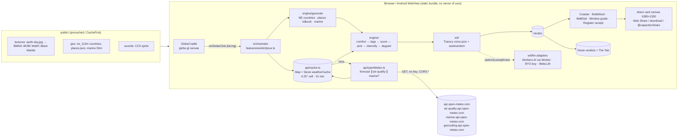

# Barometer — ARCHITECTURE.md

**Project:** 04 · The Contextual Weather Bartender (codename "Barometer", design "The Globe Bar") · **Date:** 2026-09-06
**Binding:** `_shared/DECISIONS.md` (D1 stack, D2 hosting, D3 Android, D4 wit ladder, D5 licences, D6 layout, D7 tokens, D8 row 04), `docs/RESEARCH.md` (every API/library below is verified there), `docs/DESIGN.md` (components, routes, motion, tokens).

---

## 1. Stack

| Layer | Choice (pinned) | Why here |
|---|---|---|
| Build / UI | **Vite 8.2 + React 19 + TypeScript 5 (strict)** | D1; Vite 8.2 needs Node `^20.19 || >=22.12` (owner has 22.17) |
| Styling | **Tailwind CSS v4** (`@tailwindcss/vite`, `@theme inline` bridge) + hand-written CSS for the bar (wood grain, brass, neon, window weather) with tokens in `src/styles/tokens.css` (DESIGN §15) | The bar is DOM/SVG/CSS; Tailwind only for layout utilities |
| Motion | **motion 13.2** (`motion/react`) with the presets in DESIGN §7 (`soft {220,26}`, `snappy {420,34}`, `drop {500,18}`); `MotionConfig reducedMotion="user"` | Coaster slide, pin drop, dial swing, flip, sign; no GSAP in the MVP |
| Globe (MVP) | **globe.gl 2.46.2** (three 0.185.1) | `onGlobeClick({lat,lng})`, `pointOfView`, `ringsData`, `htmlElementsData`, atmosphere, bump/specular; `globeMaterial()` hook lets the shader globe slot in later |
| Globe (someday) | **@react-three/fiber 9.7 + @react-three/drei 10.7 + postprocessing 6.39 (Zlib) / @react-three/postprocessing 3.1** + **solar-calculator 0.3** | Day/night terminator, city lights, bloom; §5.9 |
| Geo | **d3-geo 3.1** (`geoContains`, `geoArea`, `geoDistance`) + **kdbush 4.1** + **geokdbush 2.1** | Spherical point-in-polygon (antimeridian/pole safe) and nearest city in < 1 ms |
| Sun | **suncalc 2.0.2** (BSD-2 per repo LICENSE) | Golden hour, sun altitude for the window sky |
| Text | **tracery-grammar 2.8.4** + **seedrandom 3.0.5** | Rung 0 of the wit ladder; deterministic per `(lat, lng, hour, menu)` |
| State | **Zustand 5** (UI, verdict, settings) + **Dexie 4** (`verdicts`, `weatherCache`) with `dexie-react-hooks` `useLiveQuery` | Local-first; the Tab survives reloads; multi-tab safe |
| Routing | **React Router 7** `createHashRouter` | GitHub Pages sub-path, deep links `#/v/19.08,72.88` |
| PWA | **vite-plugin-pwa 1.3** (Workbox) | Precache shell + fonts + geo + drinks + grammar + first-paint texture; runtime CacheFirst for the big textures |
| Audio | **howler 2.2.4** sprite for one-shots + raw **Web Audio** for beds (neon buzz, rain/wind, thunder) | Zero-asset ambience; CC0 one-shots |
| Fonts | `@fontsource/righteous` (400), `@fontsource-variable/space-grotesk`, `@fontsource-variable/jetbrains-mono` (Latin subsets) | DESIGN §5; self-hosted, `font-display: swap` |
| Icons | **lucide-react** | Back Office / sheet chrome only |
| Primitives | **shadcn/ui on Base UI** (dialog/sheet, switch, slider, tooltip) restyled via tokens | DESIGN §10 |
| Android | **Capacitor 8.5.1** + `@capacitor/{app,haptics,share,filesystem,preferences,status-bar,splash-screen,geolocation}` | D3; built in Actions with the shared templates |
| Data prep | Node scripts (`scripts/*.mjs`) + **sharp** (textures) | Run locally, outputs committed to `public/` and `src/data/` |
| Tests | **Vitest** + Testing Library; **Playwright** (+ `@axe-core/playwright`) e2e/screenshots; manual Android checklist | Engine golden fixtures first (D9.2) |
| Lint/format | **Biome** | One tool |

**Deviations from D1:** none. GSAP is not used. R3F is deferred (D8 says "globe.gl for MVP → R3F custom shader globe").

---

## 2. System diagram



Data flow per click: `click → pin/fly (no wait) → blank coaster (A1) → [geocode offline ≤ 20 ms] ∥ [cache lookup → fetch ≤ 6 s timeout] → engine ≤ 5 ms → text → printed coaster replaces the skeleton in place → Dexie write → bottle nod + dial swing + window grade + receipt print`.

---

## 3. Folder layout (D6)

```
barometer/
├── .github/workflows/
│   ├── pages.yml                    # from _shared/templates/pages.yml
│   ├── ci.yml                       # typecheck + biome + vitest + build + bundle budget + Playwright
│   ├── live.yml                     # weekly @live probe of the three Open-Meteo hosts
│   └── android-release.yml          # from _shared/templates/android-release.yml
├── android/                         # Capacitor shell (committed; `npx cap add android`)
├── public/
│   ├── textures/                    # earth-day.jpg (245 KB first paint), bmng-{month}-4k.webp, bmng-{month}-8k.webp,
│   │                                # black-marble-4k.webp, black-marble-8k.webp, earth-topology.png, earth-water.png, night-sky.png
│   ├── geo/                         # countries-110m.json (rewound, bboxed), countries-50m.json (lazy), places.json (stripped 7.3k),
│   │                                # marine-50m.json, land-dots.json (SVG fallback globe)
│   ├── sounds/                      # bar.ogg + bar.json sprite map, hum.ogg, ATTRIBUTION.md
│   └── icons/                       # generated by @vite-pwa/assets-generator from design/icon.svg
├── scripts/
│   ├── prep-geo.mjs                 # raw/ NE GeoJSON → public/geo/* (rewind, bbox, strip, dots)
│   ├── prep-drinks.mjs              # raw/iba-cocktails + raw/opendrinks → src/data/drinks.json (normalised recipes)
│   ├── prep-textures.mjs            # raw/ NASA JPEG → 4K/8K WebP with sharp
│   └── sample-voice.mjs             # 1,000 verdicts per fixture → distinct-line report
├── src/
│   ├── app/                         # main.tsx, router.tsx (hash), providers (MotionConfig, audio unlock), Bar layout shell
│   ├── features/
│   │   ├── globe/                   # GlobeCradle (globe.gl), SvgGlobe fallback, pin, ripple, keyboard control, fly-to
│   │   ├── verdict/                 # pour.ts (orchestrator), Coaster, IntensifierStamp, GlasswareSVG, ReceiptStrip, Recipe back, BaristaTag
│   │   ├── backbar/                 # BackBar, Bottle shelf, WallDial, NeonSign (wordmark + BAR/BARISTA)
│   │   ├── window/                  # Window sky + weather layers (droplets, frost, rain, snow, fog, glare, lightning)
│   │   ├── register/                # RegisterDisplay ticker, Receipt, tear-off, shareCard.ts (canvas)
│   │   ├── tab/                     # The Tab list, export/import
│   │   ├── office/                  # Back Office settings sheet
│   │   └── search/                  # classified-ad search (Open-Meteo geocoding), Where am I
│   ├── engine/                      # PURE, framework-free, 100 % unit-tested
│   │   ├── comfort.ts               # heatIndex, humidex, windChill, dewPoint, beaufort, uvBand, aqiBand, wmo
│   │   ├── tags.ts                  # extractTags(features) → TagScore[]
│   │   ├── score.ts                 # scoreDrinks(tags, menu, opts)
│   │   ├── pick.ts                  # seeded top-3 pick, second opinion
│   │   ├── intensify.ts             # stamp tier, dial label, grade family
│   │   ├── daypart.ts               # local hour/day-part from tz + sunrise/sunset + is_day
│   │   ├── units.ts                 # °C/°F, km/h/mph/kn, formatting with U+2212
│   │   ├── terminator.ts            # subsolar point (solar-calculator), ticker city selection
│   │   ├── geocode/
│   │   │   ├── countries.ts         # bbox pre-bucket + d3.geoContains
│   │   │   ├── places.ts            # kdbush/geokdbush nearest city
│   │   │   ├── marine.ts            # ocean/sea name
│   │   │   └── index.ts             # locate(lat,lng) → PlaceHit
│   │   ├── fixtures/                # 11 golden fixtures: 9 weather + 2 error (C5)
│   │   └── index.ts                 # judge(input) → Verdict (no I/O)
│   ├── data/
│   │   ├── drinks.json              # generated: normalised recipes from IBA + Open Drinks (MIT)
│   │   ├── bar-menu.json            # hand-authored: 40 drinks (20 bar + 20 barista) — affinities, serve, glass, colour, virginTwin
│   │   ├── cities-ticker.json       # ~80 cities {name, tz, lat, lng} for the register ticker
│   │   └── attribution.json         # rendered on About + receipt footer
│   ├── wit/
│   │   ├── grammar/voice.json       # Tracery: origin, placeLine, jab_<tag>, drinkLine, serveLine_<serve>, closer_<tag>, hedges
│   │   ├── grammar/intensifiers.json# stamp text per serve family × tier
│   │   ├── tracery.ts               # buildGrammar(tags, verdict) + seeded flatten
│   │   ├── engine.ts                # TextEngine chain: procedural → optional LLM paraphrase (D4)
│   │   └── llm/                     # openaiCompat.ts, gemini.ts, webllm.ts, workersAi.ts, keyVault.ts (all optional, lazy)
│   ├── api/
│   │   ├── openMeteo.ts             # forecast(), airQuality(), marine(), geocode(); AbortController, 429 handling
│   │   ├── nominatim.ts             # optional, throttled, cached
│   │   └── cache.ts                 # cellKey(), get/set with TTL, memory + Dexie
│   ├── state/
│   │   ├── store.ts                 # Zustand: bar phase, shift, menu, verdict, settings
│   │   └── db.ts                    # Dexie schema (verdicts, weatherCache)
│   ├── audio/                       # sprite.ts (Howler), beds.ts (Web Audio graph), unlock.ts
│   ├── motion/springs.ts            # soft / snappy / drop presets
│   ├── components/ui/               # shadcn primitives restyled (BrassPlate, Lever, BrassKnob, Sheet, Tooltip, Toast)
│   ├── styles/
│   │   ├── tokens.css               # DESIGN §15 verbatim
│   │   ├── index.css                # Tailwind import + @theme inline bridge + materials (wood, brass, paper, neon)
│   │   └── window.css               # weather layers, keyframes, reduced-motion overrides
│   └── platform/                    # haptics.ts, share.ts, prefs.ts, geolocation.ts, statusBar.ts (Capacitor vs web)
├── e2e/                             # Playwright: screens × shifts, network allow-list, axe, reduced motion
├── docs/                            # this folder
├── design/preview.html              # visual contract + design/icon.svg
├── capacitor.config.ts
├── vite.config.ts
└── biome.json
```

---

## 4. Data model (TypeScript)

```ts
// ---------- geography ----------
export interface LatLng { lat: number; lng: number }            // degrees, lng in [-180, 180]

export interface PlaceHit {
  kind: 'land' | 'ocean' | 'ice';
  country?: { name: string; iso2: string; continent: string; subregion: string };
  nearestCity?: { name: string; country: string; iso2: string; distanceKm: number; isCapital: boolean; pop: number };
  water?: { name: string; featurecla: string };                 // "Arabian Sea", "ocean" | "sea" | "gulf" | "bay" …
  polar: boolean;                                               // |lat| >= 66.5
  label: string;                                                // "~38 km from Mumbai, India" | "You are in the Arabian Sea"
}

// ---------- weather (normalised from Open-Meteo) ----------
export interface WeatherSnapshot {
  fetchedAt: number;                 // epoch ms (client clock)
  cellKey: string;                   // "19,73" — 0.25° cell, default number formatting (C10)
  timezone: string;                  // IANA, from timezone=auto
  utcOffsetSeconds: number;
  current: {
    time: string;                    // local ISO without offset, e.g. "2026-09-06T00:45"
    tempC: number; apparentC: number; rh: number; dewPointC: number;
    precipMm: number; rainMm: number; showersMm: number; snowCm: number;
    wmo: number; cloudCover: number; pressureHpa: number;
    windKmh: number; gustKmh: number; windDir: number;
    isDay: boolean;
  };
  hourNow: { uv: number; precipProb: number };                  // hourly row matching current hour
  daily: { sunrise: string; sunset: string; uvMax: number; tMaxC: number; tMinC: number };
  air?: { euAqi: number; usAqi: number; pm25: number; pm10: number; ozone: number; dust: number; uv: number };
  marine?: { waveHeightM: number; sstC: number; windWaveM: number };
}

// ---------- engine ----------
export type Tag =
  | 'scorching' | 'hot' | 'warm' | 'mild' | 'chilly' | 'cold' | 'freezing' | 'arctic'
  | 'muggy' | 'oppressive' | 'bone-dry'
  | 'drizzle' | 'rain' | 'downpour' | 'snow' | 'blizzard' | 'hail' | 'storm' | 'fog'
  | 'still' | 'breezy' | 'gale' | 'uv-extreme' | 'smog' | 'dust'
  | 'dawn' | 'morning' | 'brunch' | 'afternoon' | 'golden' | 'evening' | 'late'
  | 'ocean' | 'polar';

export type TagFamily = 'temp' | 'humidity' | 'precip' | 'wind' | 'uv' | 'air' | 'daypart' | 'place';

export interface TagScore { tag: Tag; family: TagFamily; intensity: number /* 0..1 */; weight: number /* base × (1+intensity) */ }

export interface Features {                // derived, unit-tested, all °C / km/h
  apparentC: number; heatIndexC: number | null; humidexC: number | null; windChillC: number | null;
  dewPointC: number; rh: number; beaufort: number; uv: number;
  euAqi: number | null; usAqi: number | null; dust: number | null;
  wmo: number; precipMm: number; precipProb: number; snowCm: number; windKmh: number; gustKmh: number; isDay: boolean;
  localHour: number; localMinute: number; localWeekday: number /* 0=Sun */; minutesToSunrise: number; minutesToSunset: number;
  polarApproximateTime: boolean;            // the timezone was a guess; the copy hedges
  place: PlaceHit;
  marine?: { waveHeightM: number; sstC: number };
}

export type Serve = 'frozen' | 'iced' | 'chilled' | 'neat' | 'warm' | 'hot';
export type Base = 'rum' | 'gin' | 'whisky' | 'tequila' | 'vodka' | 'brandy' | 'wine' | 'beer' | 'amaro' | 'tea' | 'coffee' | 'cocoa' | 'soda' | 'juice' | 'none';
export type Glass = 'rocks' | 'highball' | 'coupe' | 'mug' | 'copper-mug' | 'tiki' | 'flute' | 'pint' | 'teacup';

export interface Drink {                   // src/data/bar-menu.json entries
  id: string;                              // "mojito"
  name: string;                            // "Mojito"  (Title Case; "Dark 'n' Stormy" keeps apostrophes)
  base: Base; alcoholic: boolean; abv: number; serve: Serve; glass: Glass;
  ice: 'cubes' | 'crushed' | 'none'; colour: string;            // fill for GlasswareSVG, e.g. "#CFE8D2"
  affinity: Partial<Record<Tag, number>>;  // 0..8 per tag
  virginTwin?: string;                     // drink id in the barista menu
  bottle: BottleId;                        // which back-bar bottle nods
  recipeId?: string;                       // key into drinks.json (IBA/Open Drinks), else inline
  recipe: Recipe;                          // resolved at build (prep-drinks) so runtime needs one file
}
export type BottleId = 'rum' | 'gin' | 'whisky' | 'tequila' | 'vodka' | 'vermouth' | 'bitters' | 'syrup' | 'tea' | 'cocoa' | 'ginger-beer' | 'mint';

export interface Recipe {
  ingredients: { amount: number | null; unit: 'ml' | 'tsp' | 'dash' | 'leaf' | 'wedge' | 'top' | 'pinch' | ''; ingredient: string }[];
  method: string[];                        // ≤ 3 lines, in-house text
  glass: Glass; garnish?: string;
  source: 'iba' | 'opendrinks' | 'house'; sourceLicence: 'MIT' | 'own';
}

export interface Verdict {
  id?: number;                             // Dexie autoincrement
  createdAt: number;
  lat: number; lng: number;                // clicked, 4 dp
  cell: string;                            // cellKey(lat, lng) — powers "have I poured here recently"
  place: PlaceHit;
  timezone: string; localTime: string;     // "02:14"
  shift: 'day' | 'night';
  menu: 'bar' | 'barista';
  features: Features;
  tags: TagScore[];                        // sorted by weight desc
  drivingTag: Tag;                         // first match in the §5.2 PRIORITY list — NOT tags[0] (C6)
  thermalTag: Tag | null;                  // highest-weight temp/humidity tag → dial label
  dial: 'ARCTIC' | 'FREEZING' | 'CHILLY' | 'FAIR' | 'MUGGY' | 'SOUP' | 'SCORCHING';
  dialAngle: number;                       // index × 40 − 120, i.e. −120…+120
  gradeFamily: 'heat' | 'muggy' | 'cold' | 'rain' | 'snow' | 'storm' | 'fog' | 'sodium' | 'none';
  drinkId: string; runnersUp: string[];    // top-3 minus the pick, for "second opinion"
  stamp: { text: string; tier: 0 | 1 | 2; ink: 'hot' | 'iced' | 'storm' | 'barista' | 'ink' };
  lines: { place: string; time: string; jab: string; drink: string; serve: string; closer: string; hedge?: string };
  suggestBarista: boolean;                 // localHour < 11 && menu === 'bar' && dayPart !== 'late'
  stale?: boolean;                         // served from cache older than 15 min (offline)
  seed: string;                            // "19.1|72.9|0|bar" — the Mumbai fixture's local hour is 0
}

// ---------- persistence ----------
export interface WeatherCacheEntry { key: string; fetchedAt: number; snapshot: WeatherSnapshot }
export interface Settings {
  shift: 'follow' | 'night' | 'day'; units: { temp: 'C' | 'F'; wind: 'kmh' | 'mph' | 'kn' };
  menuDefault: 'bar' | 'barista'; sound: boolean; volume: number /* 0..1 */; haptics: boolean;
  motion: 'full' | 'less'; gentler: boolean; nominatim: boolean;
  ai: { rung: 0 | 1 | 2 | 3; provider?: 'gemini' | 'openrouter' | 'groq'; remember: boolean };
}
export interface TickerCity { name: string; tz: string; lat: number; lng: number }
```

Dexie schema (`src/state/db.ts`):

```ts
export class BarDB extends Dexie {
  verdicts!: Table<Verdict, number>;
  weatherCache!: Table<WeatherCacheEntry, string>;
  constructor() {
    super('barometer');
    this.version(1).stores({
      verdicts: '++id, createdAt, cell, drinkId, [lat+lng]',
      weatherCache: 'key, fetchedAt',
    });
  }
}
```

Settings live in Zustand with `persist` → `localStorage` on web / `@capacitor/preferences` on Android (`src/platform/prefs.ts` storage adapter).

---

## 5. Key algorithms

All of §5.1–§5.7 live in `src/engine` and are pure functions with golden tests. Worked examples use the nine golden fixtures of IMPL §10.2 — the same roster TESTING §2.1 lists, and no other places. **Where this file and `docs/IMPLEMENTATION-PROMPT.md` disagree on a number, IMPL wins**: its §0 conflict ledger is the resolution record, and every value below has been brought into line with it.

### 5.1 Comfort formulas (`comfort.ts`)

```ts
export const cToF = (c: number) => c * 9 / 5 + 32;
export const fToC = (f: number) => (f - 32) * 5 / 9;

/** NWS/Rothfusz heat index. NEVER returns null: below the 80 °F gate it returns the *simple*
 *  value with `applies: false`, so callers always have a number (IMPL §6.1, TESTING T-CF-2). */
export function heatIndex(tempC: number, rh: number): { hiF: number; hiC: number; applies: boolean; adjustment: number } {
  const T = cToF(tempC);
  const simple = 0.5 * (T + 61 + 1.2 * (T - 68) + 0.094 * rh);
  if (simple < 80) return { hiF: simple, hiC: fToC(simple), applies: false, adjustment: 0 };
  const rothfusz = -42.379 + 2.04901523 * T + 10.14333127 * rh - 0.22475541 * T * rh
    - 0.00683783 * T * T - 0.05481717 * rh * rh + 0.00122874 * T * T * rh
    + 0.00085282 * T * rh * rh - 0.00000199 * T * T * rh * rh;
  let HI = rothfusz;
  if (rh < 13 && T >= 80 && T <= 112) HI -= ((13 - rh) / 4) * Math.sqrt((17 - Math.abs(T - 95)) / 17);
  if (rh > 85 && T >= 80 && T <= 87) HI += ((rh - 85) / 10) * ((87 - T) / 5);
  return { hiF: HI, hiC: fToC(HI), applies: true, adjustment: HI - rothfusz };
}
// Worked: 35 °C (95 °F), RH 50 → HI ≈ 105 °F ≈ 40.7 °C.

/** Canadian humidex from air temp and dew point (°C). Flags a dew point above the air temp
 *  rather than throwing — bad marine rows do exist (IMPL §6.1). */
export function humidex(tempC: number, dewC: number): { value: number; suspicious: boolean } {
  const e = 6.11 * Math.exp(5417.753 * (1 / 273.16 - 1 / (273.15 + dewC)));
  return { value: tempC + 0.5555 * (e - 10), suspicious: dewC > tempC };
}
// Worked (Mumbai probe): T 25.4, Td 24.4 → e ≈ 31.1 hPa → humidex ≈ 37.1 ("great discomfort" band 30–39).

/** JAG/TI wind chill; valid for T ≤ 10 °C and v > 4.8 km/h, else null. */
export function windChillC(tempC: number, windKmh: number): number | null {
  if (tempC > 10 || windKmh <= 4.8) return null;
  const v = Math.pow(windKmh, 0.16);
  return 13.12 + 0.6215 * tempC - 11.37 * v + 0.3965 * tempC * v;
}
// Worked: −45 °C, 6 km/h → v^0.16 = 1.332 → 13.12 − 27.97 − 15.14 − 23.76 = −53.8 °C.

/** Magnus dew point — used only when the API omits dew_point_2m (marine-only cells).
 *  Guards rh <= 0, where Math.log(0) would otherwise produce NaN (IMPL §6.1, TESTING T-CF-5). */
export function dewPointC(tempC: number, rh: number): number | null {
  if (rh <= 0) return null;
  if (rh >= 100) return tempC;
  const g = Math.log(rh / 100) + (17.62 * tempC) / (243.12 + tempC);
  return (243.12 * g) / (17.62 - g);
}
// Worked: 25.4 °C, RH 94 → γ = 1.6048 → Td = 24.36 (API said 24.4 ✓).

export function beaufort(kmh: number): number {          // 0..12
  const t = [1, 5, 11, 19, 28, 38, 49, 61, 74, 88, 102, 117];
  return t.findIndex(u => kmh <= u) === -1 ? 12 : t.findIndex(u => kmh <= u);
}
export const uvBand = (uv: number) => uv < 3 ? 'low' : uv < 6 ? 'moderate' : uv < 8 ? 'high' : uv < 11 ? 'very-high' : 'extreme';
export const euAqiBand = (a: number | null) =>                   // null is a real case: the AQI fetch is best-effort
  a === null ? 'unknown' : a <= 20 ? 'good' : a <= 40 ? 'fair' : a <= 60 ? 'moderate' : a <= 80 ? 'poor' : a <= 100 ? 'very-poor' : 'extremely-poor';
```

WMO `weather_code` table (`wmo.ts`): 0 clear · 1–3 partly/overcast · 45/48 fog · 51/53/55 drizzle · 56/57 freezing drizzle · 61/63/65 rain · 66/67 freezing rain · 71/73/75 snow · 77 snow grains · 80–82 rain showers · 85/86 snow showers · 95 thunderstorm · 96/99 thunderstorm with hail.

### 5.2 Features → tags with intensity (`tags.ts`)

> **The band table lives in one place only: `docs/IMPLEMENTATION-PROMPT.md` §6.3** (ledger C2 — it reproduces TESTING §2.3, which was declared the contract). The table that used to sit here carried a superseded set of edges (hot 30–38, muggy 21–24, `bone-dry` on RH alone, gale at 39 km/h, `hail` emitting `storm` as well) and is deliberately gone rather than duplicated: two copies of a threshold table is how a golden value drifts. What follows is the shape of the module and the facts a reader of *this* file needs.

Each rule emits at most one tag per family (temperature and humidity are exclusive bands; `hail` may sit beside another precipitation tag; `blizzard` **replaces** `snow`). `intensity` is how far into the band the value sits (0–1, clamped); **`weight = base × (1 + intensity)`**. Temperature is evaluated on the API's `apparent_temperature`, never on a locally recomputed value.

Three edges are worth memorising because they are the ones every reviewer gets wrong: `bone-dry` needs **both** `Td < 5` **and** `RH < 25`; `39 ≤ v < 62` with gusts under 60 produces **no** wind tag at all (a deliberate gap — `gale` is `v ≥ 62` **or** `g ≥ 60`); and `hail` (wmo 96/99) does **not** also emit `storm` (wmo 95).

```ts
export function extractTags(f: Features): TagScore[] {
  const out: TagScore[] = [];
  const add = (tag: Tag, family: TagFamily, intensity: number, base: number) => {
    const i = clamp01(intensity);
    out.push({ tag, family, intensity: i, weight: base * (1 + i) });
  };
  const A = f.apparentC;
  if      (A >= 38) add('scorching', 'temp', (A - 38) / 8,  1.3);
  else if (A >  28) add('hot',       'temp', (A - 28) / 10, 1.0);
  /* … the remaining rows exactly as IMPL §6.3 lists them … */
  return out.sort((a, b) => b.weight - a.weight);   // ordering only — see the driving tag below
}
```

**The driving tag is not `tags[0]`** (ledger C6). `weight` orders the array and feeds drink scoring; the *driving* tag — which sets the dial grade, the stamp family and the window tint — is the first match in this priority list:

```
hail, storm, arctic, scorching, blizzard, oppressive, downpour, freezing, dust, smog,
uv-extreme, gale, snow, hot, muggy, rain, cold, fog, drizzle, chilly, bone-dry,
breezy, warm, mild, still, ocean, polar, <the day-part tag>
```

`ocean` and `polar` sit near the bottom on purpose: the ocean never drives the dial, the coaster copy handles it. **Grade family** from the driving tag: `scorching|hot|uv-extreme → heat` · `muggy|oppressive → muggy` · `chilly|cold|freezing|arctic → cold` · `rain|drizzle|downpour → rain` · `snow|blizzard → snow` · `storm|hail|gale → storm` · `fog|smog|dust → fog` · `late|evening → sodium` · anything else → `none`.

**Worked example A — Mumbai fixture (2026-09-06 00:45 local):** A 31.5, Td 24.4, RH 94, wmo 51, v 1.9, g 2.9, isDay 0, EU AQI 34, UV 0 →
`oppressive` (i 0.10, w 1.43) · `hot` (i 0.35, w **1.35**) · `late` (00:45 is 45 min from 01:30 → i 0.70, w 1.02) · `drizzle` (i 0.30, w 0.78) · `still` (w 0.20). Sorted: **oppressive 1.43**, hot 1.35, late 1.02, drizzle 0.78, still 0.20. Driving tag = `oppressive` → dial **SOUP**, grade family *muggy* (window tint `#1B6F6A` 22 %), stamp coloured by `--stamp`.

**Worked example B — Yakutsk fixture (2026-01-14 03:10 local):** A −48.7, Td −44.2, RH 78, wmo **71 (light snow)**, v 5.5, g 9.0, isDay 0, lat 62.03 →
`arctic` (i 0.948, w 2.73) · `snow` (i 0.30, w 1.17) · `late` (03:10 → i 0.333, w 0.80) · `still` (w 0.20). Driving = `arctic` → dial **ARCTIC**, grade *cold* (`#9FD8FF` 20 %), frost creep (A ≤ −10).

The nine golden fixtures and their expected tag sets are tabulated once, in IMPL §6.3 / TESTING §2.3. `denver-hail` carries **`gale`**, not `breezy` (ledger C7: gusts 78 ≥ 60), and its dial is still FAIR because the dial reports the thermal tag.

### 5.3 Drink scoring (`score.ts`)

```ts
const WARM_SIDE: Tag[] = ['hot', 'scorching', 'muggy', 'oppressive'];
const COLD_SIDE: Tag[] = ['cold', 'freezing', 'arctic'];
const SERVE_BONUS: Record<'warm' | 'cold' | 'chilly', Record<Serve, number>> = {
  warm:   { frozen: 3, iced: 2, chilled: 1, neat: 0, warm: -2, hot: -3 },
  cold:   { frozen: -4, iced: -3, chilled: -1, neat: 1, warm: 2, hot: 2 },
  chilly: { frozen: -2, iced: -1, chilled: 0, neat: 1, warm: 1, hot: 1 },
};

export function scoreDrinks(tags: TagScore[], menu: Drink[], opts: { lastDrinkId?: string }): { drink: Drink; score: number }[] {
  const has = (t: Tag) => tags.some(s => s.tag === t);
  return menu.map(drink => {
    let s = 0;
    for (const t of tags) s += (drink.affinity[t.tag] ?? 0) * t.weight;
    if (WARM_SIDE.some(has)) s += SERVE_BONUS.warm[drink.serve];
    if (COLD_SIDE.some(has)) s += SERVE_BONUS.cold[drink.serve];
    if (has('chilly')) s += SERVE_BONUS.chilly[drink.serve];
    if (opts.lastDrinkId === drink.id) s -= 2;              // session-only repeat penalty (C8)
    return { drink, score: s };
  }).sort((a, b) => b.score - a.score);
}
```

`menu` is already filtered: BAR = `alcoholic === true` (20 drinks), BARISTA = `alcoholic === false` (20 drinks). Every cocktail names a `virginTwin`, so the Barista flip re-prints without re-scoring. The menu itself is defined once, in IMPL §6.11, under a hard rule: **every one of the 34 tags has ≥ 3 drinks at affinity ≥ 3**, asserted by `scripts/check-menu.mjs`.

**Worked example A (Mumbai, BAR menu)** — a selection of the twenty bar drinks; the full ranking is snapshot-pinned:

| Drink | serve | affinity (relevant) | Σ affinity × weight | serve | **score** |
|---|---|---|---|---|---|
| Mojito | iced | oppressive 4, hot 3, late 1 | 4·1.43 + 3·1.35 + 1·1.02 = 10.79 | +2 | **12.79** |
| Caipirinha | iced | hot 3, oppressive 3, still 1 | 4.05 + 4.29 + 0.20 = 8.54 | +2 | 10.54 |
| Espresso Martini | chilled | late 4, hot 1 | 4.08 + 1.35 = 5.43 | +1 | 6.43 |
| Moscow Mule | iced | hot 3 | 4.05 | +2 | 6.05 |
| Dark 'n' Stormy | iced | hot 1 | 1.35 | +2 | 3.35 |
| Hot Toddy | hot | drizzle 2 | 1.56 | −3 | −1.44 |

**Worked example B (Yakutsk, BAR menu):**

| Drink | serve | affinity | Σ | serve | **score** |
|---|---|---|---|---|---|
| Hot Buttered Rum | hot | arctic 5, snow 3, late 1 | 13.65 + 3.51 + 0.80 = 17.95 | +2 | **19.95** |
| Mulled Wine | hot | arctic 3, snow 3 | 8.19 + 3.51 = 11.69 | +2 | 13.69 |
| Hot Toddy | hot | arctic 2, snow 2 | 5.46 + 2.34 = 7.80 | +2 | 9.80 |
| Mojito | iced | — | 0 | −3 | −3.00 |

### 5.4 Seeded pick and the second opinion (`pick.ts`)

```ts
import seedrandom from 'seedrandom';
export const seedFor = (lat: number, lng: number, localHour: number, menu: 'bar' | 'barista') =>
  `${lat.toFixed(1)}|${lng.toFixed(1)}|${localHour}|${menu}`;                 // C11: pipe-delimited, menu included

export function pick(ranked: { drink: Drink; score: number }[], seed: string): { pick: Drink; runnersUp: Drink[] } {
  let top = ranked.slice(0, 3).filter(r => r.score > 0);   // never draw a negative-score drink
  if (top.length === 0) top = ranked.slice(0, 1);
  const [first, second] = top;
  if (!first) throw new Error('pick(): empty menu');
  const dominant = second === undefined || first.score - second.score >= 4;   // clear winner → no roll
  let idx = 0;
  if (!dominant) {
    const r = seedrandom(seed)();                          // deterministic per place/hour/menu
    idx = r < 0.85 ? 0 : r < 0.96 ? 1 : 2;                 // 85 / 11 / 4 % — the code matches the prose
    if (idx >= top.length) idx = top.length - 1;
  }
  const chosen = top[idx] ?? first;
  return { pick: chosen.drink, runnersUp: top.filter(t => t !== chosen).map(t => t.drink) };
}
```

The full function in IMPL §6.5 adds the **ocean rule** (an ocean click is forced onto the highest-ranked drink with `affinity.ocean ≥ 5`, so the Arabian Sea always prints the Dark 'n' Stormy). Mumbai: margin 12.79 − 10.54 = 2.25 < 4 → seeded roll among Mojito / Caipirinha / Espresso Martini with seed `19.1|72.9|0|bar`, whose first draw is 0.320658 < 0.85, so the Mojito wins deterministically. Yakutsk: margin 6.26 ≥ 4 → always Hot Buttered Rum, no roll. Denver: margin 7.45 ≥ 4 → always Dark 'n' Stormy. South Pole: margin 6.80 ≥ 4 → always Hot Buttered Rum. Neighbouring clicks 0.1° apart change the seed, so the same coast does not print the same coaster twice in a row. "Second opinion" (coaster swipe) cycles through `runnersUp`.

### 5.5 Intensifier stamp, dial label, grade (`intensify.ts`)

```ts
const COLD_INTEN: Tag[] = ['chilly', 'cold', 'freezing', 'arctic'];
const inten = (tags: TagScore[], ...names: Tag[]) => Math.max(0, ...tags.filter(t => names.includes(t.tag)).map(t => t.intensity));
const has = (tags: TagScore[], t: Tag) => tags.some(s => s.tag === t);

export function stampFor(tags: TagScore[], drink: Drink, menu: 'bar' | 'barista', gentler: boolean): Verdict['stamp'] {
  const stormy = has(tags, 'storm') || has(tags, 'hail');
  const coldServe = drink.serve === 'hot' || drink.serve === 'warm' || drink.serve === 'neat';
  const score = coldServe
    ? inten(tags, ...COLD_INTEN) + (has(tags, 'arctic') ? 0.5 : 0) + (has(tags, 'gale') ? 0.3 : 0)
    : inten(tags, 'hot', 'scorching') + inten(tags, 'muggy', 'oppressive') + (has(tags, 'oppressive') ? 0.5 : 0) + (has(tags, 'scorching') ? 0.5 : 0);
  let tier: 0 | 1 | 2 = score < 0.5 ? 0 : score < 1.2 ? 1 : 2;
  const family = stormy ? 'storm' : coldServe ? 'hot' : 'iced';
  if (stormy) tier = 2;                          // a storm is never understated…
  if (gentler && tier === 2) tier = 1;           // …unless the gentler lever is on
  const key = family === 'storm' ? 'storm' : drink.serve;   // the storm family is keyed by itself, not by serve
  return { text: INTENSIFIERS[family][key][tier], tier, ink: menu === 'barista' ? 'barista' : family };
}
```

`src/wit/grammar/intensifiers.json` is the **single source for every stamp string** (ledger C12). It is reproduced in full in IMPL §6.6; do not paraphrase it, do not hard-code a stamp in a test, and note that the `hot` family has **separate `warm` and `hot` ladders** (`WARM` / `WARM, NO ARGUMENTS` / `BOTH HANDS. NOW.` versus `HOT` / `HOT, NO ARGUMENTS` / `SCALDING. DO NOT GO OUTSIDE.`) and the storm ladder ends **`DO NOT GO OUTSIDE.`**, not "UNDER THE COUNTER".

Worked: Mumbai — Mojito (iced), 0.35 + 0.10 + 0.5 = 0.95 → tier 1 → **AGGRESSIVELY ICED**. Yakutsk — Hot Buttered Rum (hot), 0.948 + 0.5 = 1.448 → tier 2 → **SCALDING. DO NOT GO OUTSIDE.** Reykjavík — Hot Toddy (hot), chilly intensity 0.79 → tier 1 → **HOT, NO ARGUMENTS**. Denver — hail ⇒ storm family, forced tier 2 → **DO NOT GO OUTSIDE.** (with `gentler: true`, tier 1 → **INDOORS. NOW.**).

`stamp.ink` does **not** colour the stamp: `--stamp` from the grade family (DESIGN §4.4 / IMPL §3.5) is the only thing that does. `ink` exists solely to carry the barista-green override and to populate the `data-ink` attribute the component tests assert.

Dial label from the *thermal tag* (highest-weight tag in families temp + humidity): arctic → ARCTIC · freezing, cold → FREEZING · chilly → CHILLY · mild, warm, bone-dry, none → FAIR · muggy → MUGGY · oppressive → SOUP · hot, scorching → SCORCHING. Needle angle = index × 40° − 120° (7 stops across −120°…+120°).

Grade family for the window and the stamp colour (DESIGN §4.4) comes from the *driving* tag, per the mapping in §5.2.

### 5.6 Local time and day-part (`daypart.ts`)

```ts
export function localClock(now: Date, tz: string) {
  const parts = new Intl.DateTimeFormat('en-GB', { timeZone: tz, hour: '2-digit', minute: '2-digit', hourCycle: 'h23', weekday: 'short' })
    .formatToParts(now);
  const get = (t: string) => parts.find(p => p.type === t)!.value;   // the two documented non-null assertions
  return { hour: +get('hour'), minute: +get('minute'), weekday: ['Sun','Mon','Tue','Wed','Thu','Fri','Sat'].indexOf(get('weekday')), label: `${get('hour')}:${get('minute')}` };
}
```

The day-part ladder is an **eight-step, first-match-wins** list; it lives in IMPL §6.4 and is reproduced here only in outline so that nobody re-derives it from an older ordering:

1. **polar with no sunrise/sunset row** → clock only (`23:00–03:59` late · `04:00–09:59` morning · `10:00–17:59` afternoon · else evening) and set `polarApproximateTime = true`;
2. `m ≥ 23:00 || m < 04:00` → `late`;
3. `|now − sunrise| ≤ 45 min` → `dawn`;
4. `goldenHourStart ≤ now ≤ sunset` (suncalc's `goldenHour`, **not** a 60-minute window) → `golden`;
5. `now > sunset` → `evening`;
6. `m < 10:00` → `morning`;
7. weekend and `m < 13:00` → `brunch`;
8. otherwise `afternoon`.

Note that `late` is tested **before** `dawn`, and that the polar branch returns a clock mapping rather than reading `is_day`. `minutesToSunrise/Sunset` come from the `daily.sunrise/sunset` local ISO strings minus `current.time` (both local, no offset needed); when the strings are empty they are `±Infinity`. `is_day` from the API is authoritative for the *shift* (Day/Night); sunrise/sunset only refine the day-part. Polar local time is phrased loosely in the grammar (RESEARCH §3: `Antarctica/McMurdo`, `Etc/GMT-7` are pragmatic guesses).
**`suggestBarista = localHour < 11 && menu === 'bar' && dayPart !== 'late'`** — at Mumbai's 00:45 the bartender does not offer you a coffee; he makes a remark about the hour.

### 5.7 Offline reverse geocoding (`engine/geocode/`)

Build step (`scripts/prep-geo.mjs`): for each Natural Earth GeoJSON feature, ensure d3's spherical winding — `if (geoArea(feature) > 2π) reverse every ring` (an inverted polygon covers "everything but the country"); compute `bbox` with `geoBounds`; keep only `ADMIN, NAME, ISO_A2, CONTINENT, SUBREGION`. Populated places: keep `name, adm0name, iso_a2, latitude, longitude, pop_max, featurecla` → `places.json` (~400 KB). Marine polygons 50m: keep `name, featurecla`.

```ts
import { geoContains, geoDistance } from 'd3-geo';
import KDBush from 'kdbush';
import { around } from 'geokdbush';

let countries: CountryFeature[]; let places: Place[]; let placeIndex: KDBush; let marine: MarineFeature[];

export async function loadGeo(base = import.meta.env.BASE_URL) {
  [countries, places, marine] = await Promise.all([
    fetch(`${base}geo/countries-110m.json`).then(r => r.json()),
    fetch(`${base}geo/places.json`).then(r => r.json()),
    fetch(`${base}geo/marine-50m.json`).then(r => r.json()),
  ]);
  placeIndex = new KDBush(places.length);
  for (const p of places) placeIndex.add(p.lng, p.lat);
  placeIndex.finish();
}

function inBBox([w, s, e, n]: number[], lng: number, lat: number) {
  if (lat < s || lat > n) return false;
  return w <= e ? lng >= w && lng <= e : lng >= w || lng <= e;     // bbox crossing the antimeridian
}

export function locate(lat: number, lng: number): PlaceHit {
  const pt: [number, number] = [lng, lat];
  const near = around(placeIndex, lng, lat, 1, 400)[0];              // nearest place within 400 km (C1)
  const city = near === undefined ? undefined : places[near];
  const distanceKm = city ? geoDistance(pt, [city.lng, city.lat]) * 6371 : Infinity;
  const nearest = city ? { nearestCity: { ...pick(city), distanceKm } } : {};
  const polar = Math.abs(lat) >= 66.5;

  // ORDER IS LOAD-BEARING: the marine polygons are tested BEFORE the country hit.
  // This is what makes the Caspian Sea (42.0, 51.0) resolve as `ocean` rather than as Kazakhstan,
  // and it matches IMPL §6.8 and the twelve golden rows of TESTING §2.5 / IMPL §6.8.
  const water = marine.find(m => inBBox(m.bbox, lng, lat) && geoContains(m, pt));
  if (water) return { kind: 'ocean', polar, water: pick(water), ...nearest, label: `You are in the ${water.name}` };

  const country = countries.find(c => inBBox(c.bbox, lng, lat) && geoContains(c, pt));
  if (country) {
    return { kind: 'land', polar, country: pick(country), ...nearest,
      label: city ? `~${Math.round(distanceKm)} km from ${city.name}, ${country.name}` : `Somewhere in ${country.name}` };
  }

  if (polar) return { kind: 'ice', polar, label: lat > 0 ? 'On the Arctic ice' : 'On the Antarctic ice' };
  return { kind: 'ocean', polar, ...nearest,
    label: city && distanceKm < 400 ? `Open water, ~${Math.round(distanceKm)} km off ${city.name}` : 'The middle of nowhere, at sea' };
}
```

Two typing notes, because `exactOptionalPropertyTypes` and `noUncheckedIndexedAccess` are both on: the nearest-city field is added by **conditional spread** (`...nearest`), never as `nearestCity: city && …`, which would evaluate to `undefined` and fail to assign to an optional property; and the open-water label branches on `city` rather than using a non-null assertion, which §13 of IMPL bans outside test files.

Costs: 177 country features × bbox test ≈ 10 µs; `geoContains` on the 1–5 candidates ≈ 1–3 ms; kdbush query < 0.1 ms; total well under the 20 ms budget. `countries-50m.json` (3.1 MB) is fetched lazily after the first verdict and swapped in for finer coastlines; the 110m file (0.8 MB) is precached.

**Golden points: there is exactly one list, the twelve rows of TESTING §2.5 (reproduced in IMPL §6.8).** Do not add a second set here — the earlier ad-hoc list in this file was a third, conflicting one and has been deleted. The rows that matter most are `(19.07, 72.88)` → IN / Mumbai / ≤ 40 km, `(42.0, 51.0)` → **ocean, Caspian Sea** (the marine-first ordering above is the only reason it passes), `(0, −140)` → open ocean, `(−72, 2.5)` → Antarctica, and the antimeridian pair `(−20, ±179.9)` resolving to the same side.
### 5.8 Weather fetch and caching (`api/`)

```ts
const q = (n: number) => Math.round(n * 4) / 4;                    // 0.25° quantisation
export function cellKey(lat: number, lng: number): string {        // C10 — no toFixed anywhere
  let x = q(lng);
  if (x === 180) x = -180;                                         // antimeridian: 179.9 and -179.9 share a cell
  return `${q(lat)},${x}`;                                         // "19,73" · "64.25,-22" · "-17.75,-180"
}
const TTL = 15 * 60_000;

export async function getWeather(lat: number, lng: number, place: PlaceHit, signal: AbortSignal): Promise<{ snap: WeatherSnapshot; stale: boolean }> {
  const key = cellKey(lat, lng);
  const hit = memory.get(key) ?? await db.weatherCache.get(key);
  if (hit && Date.now() - hit.fetchedAt < TTL) return { snap: hit.snapshot, stale: false };
  try {
    const [forecast, air, marine] = await Promise.all([
      fetchForecast(lat, lng, signal), fetchAir(lat, lng, signal).catch(() => undefined),
      place.kind === 'ocean' ? fetchMarine(lat, lng, signal).catch(() => undefined) : undefined,
    ]);
    const snap = normalise(forecast, air, marine, key);
    memory.set(key, { key, fetchedAt: snap.fetchedAt, snapshot: snap }); await db.weatherCache.put({ key, fetchedAt: snap.fetchedAt, snapshot: snap });
    return { snap, stale: false };
  } catch (e) {
    if (hit && Date.now() - hit.fetchedAt < 24 * 3_600_000) return { snap: hit.snapshot, stale: true };   // offline: re-pour from memory
    throw e;
  }
}
```

The forecast call is mandatory; AQI and marine are best-effort (their absence only removes tags). A 6 s `AbortController` timeout covers all three. `db.weatherCache` is pruned to the newest 200 entries on startup.

### 5.9 Globe: click → coordinates, fly-to, terminator (`features/globe`, `engine/terminator.ts`)

- **globe.gl (MVP):** `globe.onGlobeClick(({ lat, lng }) => pour(lat, lng))`; `globe.pointOfView({ lat, lng, altitude: 1.6 }, 1200)`; ripple `globe.ringsData([{ lat, lng }]).ringMaxRadius(6).ringPropagationSpeed(6).ringRepeatPeriod(0)`; pin via `htmlElementsData` anchored to the coordinate; `globe.controls().autoRotateSpeed = 0.35` after 8 s idle, `enableDamping = true, dampingFactor = 0.045, rotateSpeed = 0.55` (A12).
- **R3F (someday):** raycast the sphere; hit point `p`, radius `r`: `lat = 90 − deg(acos(p.y / r))`, `lng = ((deg(atan2(p.x, p.z)) + 270) % 360) − 180` (verify Greenwich against the texture with a unit test on three-globe's `polar2Cartesian` convention).
- **Subsolar point** (drives the shader terminator and the ticker's "sun setting" lines):

```ts
import * as solar from 'solar-calculator';
export function subsolar(now = new Date()): [lng: number, lat: number] {
  const day = new Date(+now).setUTCHours(0, 0, 0, 0);
  const t = solar.century(now);
  const longitude = ((day - +now) / 864e5) * 360 - 180;
  return [longitude - solar.equationOfTime(t) / 4, solar.declination(t)];
}
```

- **Register ticker** (every 60 s): for each city in `cities-ticker.json`, `localClock(now, tz)`; `LAST ORDERS IN X` if local time ∈ [23:30, 00:15); `FIRST COFFEE IN Y` if ∈ [06:30, 07:15); else `SUN SETTING OVER Z` when `suncalc.getTimes(now, lat, lng).sunset` is within ±20 min; fallback `THE BAR IS OPEN · HH:MM UTC`. Deterministic order (sorted by longitude) so tests can assert it.

### 5.10 Voice (`wit/tracery.ts`)

`voice.json` symbols: `origin` → `#placeLine# #timeLine# #jab# #drinkLine# #serveLine# #closer#`; per-tag pools `jab_oppressive`, `jab_arctic`, … (≥ 8 each); `serveLine_iced`, `serveLine_hot`, …; `closer_late`, `closer_brunch`, `closer_ocean`, `closer_polar`, `closer_default`; `hedge` lines for model data ("the models say", "allegedly"). The engine builds the grammar per verdict:

```ts
export function speak(v: Omit<Verdict, 'lines'>, grammarJson: Grammar): Verdict['lines'] {
  const rng = seedrandom(v.seed + '|voice');
  tracery.setRng(rng);                                  // deterministic flatten
  const g = tracery.createGrammar({
    ...grammarJson,
    jab: [`#jab_${v.drivingTag}#`], closer: [`#closer_${closerKey(v)}#`], serveLine: [`#serveLine_${drink(v).serve}#`],
    place: [v.place.label], time: [v.localTime], drink: [drink(v).name], stamp: [v.stamp.text],
    feels: [fmtTemp(v.features.apparentC)], dew: [fmtTemp(v.features.dewPointC)], wind: [fmtWind(v.features.windKmh)],
  });
  g.addModifiers(tracery.baseEngModifiers);
  return { place: g.flatten('#placeLine#'), time: g.flatten('#timeLine#'), jab: g.flatten('#jab#'),
           drink: g.flatten('#drinkLine#'), serve: g.flatten('#serveLine#'), closer: g.flatten('#closer#'),
           hedge: v.features.precipMm === 0 && v.features.wmo >= 51 ? g.flatten('#hedge#') : undefined };
}
```

Example output (Mumbai, seed `19.1|72.9|0|bar|voice`): *"~38 km from Mumbai, India. 00:45 local · dew point 24°. The air is soup. You are not sweating, you are marinating. **AGGRESSIVELY ICED** Mojito. Served in a bucket. It is almost one in the morning. Drink it and go to bed."* The intensifier word is marked in the drink line with the literal guillemets `«…»` — never markdown asterisks — and the renderer swaps them for `<em class="intensifier">`, Righteous at 1.6× (DESIGN §5, IMPL §3.7/§6.10, TESTING T-WT-2). Any LLM rung receives `lines` + 3 grammar samples and must return the same JSON shape; on error/timeout (6 s) the procedural lines stay (D4).

---

## 6. State management

- **Zustand `useBarStore`** (`src/state/store.ts`): `phase: 'idle' | 'flying' | 'loading' | 'printed' | 'error'`, `pin: LatLng | null`, `verdict: Verdict | null`, `secondOpinion: number`, `shift`, `menu`, `settings` (persisted), `online`, `audioUnlocked`, `webgl: 'ok' | 'lost' | 'none'`. Actions: `pour(lat,lng)`, `flipMenu()`, `nextOpinion()`, `setShift()`, `retry()`. The orchestrator `features/verdict/pour.ts` is the only writer of `verdict`.
- **Derived UI**: `data-shift` on `<html>` from `settings.shift === 'follow' ? (verdict?.shift ?? osPreference) : settings.shift`; `--grade/--stamp/--drink-glow` set on `:root` from `gradeFamily(verdict)`; bottle `picked` from `drink.bottle`; dial from `verdict.dial`.
- **Dexie** is the source of truth for The Tab (`useLiveQuery(() => db.verdicts.orderBy('createdAt').reverse().limit(50).toArray())`) and for the weather cache; Zustand holds only the current verdict.
- **Router** (`#/v/:lat,:lng`): on load, parse, validate (`|lat| ≤ 90`, `|lng| ≤ 180`, else the "Nowhere on Earth" coaster), then `pour()`. Navigating from a Tab row pushes the same route; `pour()` reuses the stored verdict if < 15 min old (no fetch).

## 7. Offline / PWA strategy

- `vite-plugin-pwa` `generateSW`, `registerType: 'prompt'` (a brass tag "New bottles in stock. Restock?"), `base`/`scope`/`start_url` = `VITE_BASE_PATH`.
- **Precache** (≈ 4.5 MB): shell, fonts (3 files, ~110 KB), `geo/countries-110m.json`, `geo/places.json`, `geo/marine-50m.json`, `geo/land-dots.json`, `textures/earth-day.jpg`, `earth-topology.png`, `earth-water.png`, `sounds/bar.ogg`, `data/*.json` (bundled in JS).
- **Runtime caching:** `textures/*.webp` and `geo/countries-50m.json` → CacheFirst, 30 days, **max 4 entries** (C4 — day 4K/8K + night 4K/8K is the whole set); `*.open-meteo.com` → **NetworkOnly** (our Dexie layer is the cache; Workbox must not serve stale API JSON silently).
- **Offline behaviour:** `navigator.onLine` + fetch failure → register prints "NO SIGNAL · SERVING FROM THE TAB"; `getWeather` returns a stale snapshot (≤ 24 h) tagged `stale` → coaster shows a brass "re-poured from memory" tag; search and Where-am-I disabled with tooltip; Tab always opens.
- `navigator.storage.persist()` requested after the first verdict. Never registered inside Capacitor (`!Capacitor.isNativePlatform()`).

## 8. Android integration points (Capacitor 8, optional build)

| Concern | Implementation |
|---|---|
| Plugins | `@capacitor/app` (back button → close sheets before route), `haptics` (DESIGN §12 map), `share` + `filesystem` (write PNG to `Directory.Cache`, `Share.share({ files: [uri] })`), `preferences` (settings adapter), `status-bar` (`overlaysWebView: true`, `Style.Dark` on Night / `Style.Light` on Day, transparent background), `splash-screen` (`#1A0F0A`, brass pin), `geolocation` (Where am I only) |
| Manifest | `INTERNET` (default), `VIBRATE`, `ACCESS_COARSE_LOCATION` + `ACCESS_FINE_LOCATION` (runtime-requested only on tap); no exact alarms, no media permissions |
| `capacitor.config.ts` | `appId 'com.rahul.barometer'`, `appName 'The Globe Bar'`, `webDir 'dist'`, `android.webContentsDebuggingEnabled: false`, `plugins.SplashScreen.backgroundColor '#1A0F0A'` |
| Build | `VITE_BASE_PATH=/ VITE_PLATFORM=android npm run build && npx cap sync android` (template workflow); `VITE_PLATFORM` selects 4K textures and DPR cap 1.5 |
| WebView | Edge-to-edge insets via `env(safe-area-inset-*)`; `touch-action: none` + `preventDefault` on `touchmove` inside the cradle with a 24 px dead margin on both edges (predictive back); `webglcontextlost` → SVG globe + "bearings seized" tag; pause `requestAnimationFrame` on `visibilitychange` |
| Native code | none (no custom plugins) |
| Signing/CI | `_shared/templates/android-release.yml` + `app-build.gradle.snippet`; keystore via `_shared/scripts/make-keystore.sh barometer` |

## 9. Third-party APIs

All no-key, `Access-Control-Allow-Origin: *` (probed 2026-09-06). Non-commercial use only; CC BY 4.0 attribution rendered in-app.

**Forecast** — `GET https://api.open-meteo.com/v1/forecast`
`?latitude=19.07&longitude=72.88&current=temperature_2m,relative_humidity_2m,apparent_temperature,dew_point_2m,precipitation,rain,showers,snowfall,weather_code,cloud_cover,pressure_msl,wind_speed_10m,wind_gusts_10m,wind_direction_10m,is_day&hourly=uv_index,precipitation_probability&daily=sunrise,sunset,uv_index_max,temperature_2m_max,temperature_2m_min&timezone=auto&forecast_days=1`
→ `{ timezone, utc_offset_seconds, current: { time, interval: 900, temperature_2m, …, is_day: 0|1 }, hourly: { time[], uv_index[], precipitation_probability[] }, daily: { sunrise[], sunset[], … } }`. 15 variables + 2 hourly + 5 daily ≈ **2 weighted calls**. Pick the `hourly` row whose `time` shares the hour of `current.time`.

**Air quality** — `GET https://air-quality-api.open-meteo.com/v1/air-quality?latitude&longitude&current=european_aqi,us_aqi,pm2_5,pm10,ozone,dust,uv_index&timezone=auto` → `current.interval: 3600`. Credit CAMS ENSEMBLE. ≈ 1 call.

**Marine** (ocean clicks only) — `GET https://marine-api.open-meteo.com/v1/marine?latitude&longitude&current=wave_height,sea_surface_temperature,wind_wave_height&timezone=auto`. Credit DWD. ≈ 0.5 call. Some coastal/inland cells return an error → treat as "no marine data".

**Geocoding (forward, search box)** — `GET https://geocoding-api.open-meteo.com/v1/search?name=Mumbai&count=5&language=en` → `results[{ name, country, admin1, latitude, longitude, timezone, population }]`. Debounced 250 ms, min 2 chars, no autocomplete under 250 ms.

**Limits & handling:** 600/min · 5,000/h · 10,000/day per IP; each land click ≤ 3 weighted calls and each ocean click ≤ 4 (marine adds ≈ 1); the 0.25° / 15 min cache makes repeats free. Headers: none required; send `Accept: application/json`. On `429` → `phase: 'error'` with the "Bar's busy. Give it a minute." coaster and a 60 s cooldown; on `4xx` (bad coords) → "Nowhere on Earth"; on timeout/network → offline path (§7). No retry storms: one retry after 1.5 s for 5xx only.

**Nominatim (optional lever, off by default)** — `GET https://nominatim.openstreetmap.org/reverse?lat&lon&format=jsonv2&zoom=10` with `Referer` (browsers cannot set UA); client throttle ≥ 1.1 s between calls, cached per cell forever in Dexie; only called after the offline label is already printed; "Data © OpenStreetMap contributors" on the coaster when used. Never in grids, never on hover.

**Optional AI rungs (D4):** rung 1 through `worker/` using `_shared/templates/worker-proxy.ts` pointed at Workers AI (fail-open → rung 0); rung 2 direct from the browser to `generativelanguage.googleapis.com` / `openrouter.ai` / `api.groq.com` with the user's key (WebCrypto vault per FREE-AI-OPTIONS §6.1, "session only" default); rung 3 `@mlc-ai/web-llm` in a Worker on desktop WebGPU only. Prompt = the procedural `lines` JSON + 3 samples; output validated against the same shape; 6 s timeout.

**Never called:** BigDataCloud (policy), TheCocktailDB (licence), timeapi.io (unverifiable terms).

## 10. Security & privacy

- CSP `<meta http-equiv="Content-Security-Policy">`: `default-src 'self'; connect-src 'self' https://api.open-meteo.com https://air-quality-api.open-meteo.com https://marine-api.open-meteo.com https://geocoding-api.open-meteo.com https://nominatim.openstreetmap.org; img-src 'self' data: blob:; style-src 'self' 'unsafe-inline'; worker-src 'self' blob:; object-src 'none'; base-uri 'none'`. BYO-LLM hosts are appended only in the settings-enabled build flag path (documented list, never wildcards).
- No `VITE_*` secrets; no owner key exists. BYO keys: AES-GCM wrapped with a non-extractable `CryptoKey` in IndexedDB, or `sessionStorage` in "session only"; shown as last-4; "Forget key"; never in URLs, logs or the share card.
- Coordinates in deep links are rounded to 2 dp (~1 km) and are the only thing a URL ever carries. `referrerpolicy="no-referrer"` on the document except where Nominatim needs the Referer (that fetch sets `referrerPolicy: 'origin'`).
- Geolocation only on the "Where am I" tap, resolved offline, never stored beyond the resulting verdict.
- The Tab export is a plain JSON file the user creates; import validates the shape with a 30-line guard and ignores unknown fields.
- Public repo hygiene: `raw/`, `*.p12`, `android/local.properties` git-ignored; no `google-services.json`.

## 11. Performance budget

| Metric | Budget | How |
|---|---|---|
| Initial JS (before globe chunk) | **≤ 180 KB gzip** (C3 — hard, fails CI) | React + router + Zustand + Dexie + Motion + engine + grammar; globe.gl/three in a lazy `import()` chunk (separately budgeted at ≤ 320 KB gzip) requested after first paint |
| LCP | DOM neon sign + brass plate, < 1.5 s on 4G mid-range Android | Fonts `swap`; canvas mounts after `requestIdleCallback`; SVG dotted globe holds the cradle meanwhile |
| Click → printed coaster | < 2.0 s (p50 < 1.2 s); skeleton within 100 ms | Parallel fetches, 6 s abort, cache |
| Engine | < 5 ms per verdict; geocode < 20 ms warm | Pure functions, prebuilt kdbush, bbox pre-test |
| Textures | first paint 245 KB `earth-day.jpg`; then 4K WebP ≈ 2 MB (Android) / 8K ≈ 6 MB (desktop) day + night lazily; total ≤ 10 MB | `MAX_TEXTURE_SIZE` probe; anisotropy 4; mipmaps; `VITE_PLATFORM` switch |
| Frame budget | 60 fps idle drift desktop, ≥ 30 fps on a 2022 mid-range Android; DPR cap 1.75 desktop / 1.5 Android | `frameloop` paused when hidden; window weather is CSS/SVG on the compositor (`transform`/`opacity` only); no shader passes in v1 |
| Precache | ≤ 12 MB total; site ≤ 40 MB (GitHub Pages 1 GB cap is not a concern) | Big textures runtime-cached, not precached |
| Memory | ≤ 300 MB on Android (WebGL context + 4K textures) | Dispose the 245 KB texture after the 4K swap |

## 12. Error handling

| Failure | User sees | Code path |
|---|---|---|
| Forecast fetch fails / times out (6 s) | Error coaster "The models are not answering. Try again." + brass RETRY; window unchanged | `phase 'error'`, `retry()` re-pours same coords |
| HTTP 429 | "Bar's busy. Give it a minute." + 60 s cooldown on the RETRY plate | `api/openMeteo.ts` throws `RateLimited` |
| Offline with cache ≤ 24 h | Coaster prints with "re-poured from memory" tag; register "NO SIGNAL · SERVING FROM THE TAB" | `stale: true` |
| Offline, no cache | Error coaster with "NO SIGNAL" line; Tab still opens | — |
| AQI/marine fails | Silent; tags simply absent; receipt shows `AQI —` | best-effort `catch(() => undefined)` |
| Bad deep link | "Nowhere on Earth has those coordinates. Impressive." + "Back to the bar" | router loader validation |
| WebGL unavailable / context lost | SVG dotted globe stays clickable (equirectangular hit-test); "The globe's bearings seized. Tap to re-seat." remounts canvas | `webgl` state |
| Texture load fails | Keep `earth-day.jpg`; log nothing; retry on next visit via CacheFirst | `onError` in globe.gl `globeImageUrl` swap |
| Fonts fail | System fallback stacks; share card waits ≤ 2 s on `document.fonts.load` then draws anyway | — |
| Share fails / unsupported | Download fallback + toast "Saved to your device" | `platform/share.ts` |
| Dexie quota / blocked | Verdict still shown; Tab write skipped with a one-time toast "The Tab is full. Export and clear." | try/catch around `db.verdicts.add` |
| Geolocation denied | Tooltip "The bar respects your privacy. Spin the globe instead." | — |
| Grammar missing a per-tag pool | Falls back to `jab_default`; a Vitest asserts every tag has ≥ 8 lines so this never ships | `buildGrammar` |

All errors are handled locally; nothing is reported anywhere.

## 13. No analytics

No analytics, telemetry, crash reporting, feature flags service, A/B testing, remote config, fonts CDN, or tag managers — in any build. The only network hosts are the four Open-Meteo APIs (always) and Nominatim / user-enabled LLM providers (opt-in). A Playwright test enforces the allow-list.
