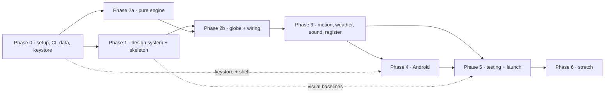

# Barometer — PLAN.md (build plan)

**Project:** 04 · The Contextual Weather Bartender (codename "Barometer", design "The Globe Bar") · **Written:** 2026-09-06
**Binding inputs:** `_shared/DECISIONS.md` (D1 stack · D2 Pages · D3 Capacitor · D4 wit ladder · D5 licences · D6 layout · D7 tokens · D8 row 04 · D9 working agreement), `GOAL.md` (success criteria 1–8, MVP/v1/Someday split), `docs/RESEARCH.md`, `docs/DESIGN.md` (tokens §15, motion §7 A1–A12, screens §9, a11y §13, assets §16), `docs/ARCHITECTURE.md` (§3 folders, §4 data model, §5 algorithms, §7 PWA, §8 Android, §9 APIs, §11 budgets, §12 errors), `docs/TESTING.md` (fixtures §2, unit IDs `T-*`, e2e `E2E-*`, `OFF-*`, `A11Y-*`, `SEC-*`, day-1 list §11, Android checklist §12, release gate §13).

## How to read this plan

- Tasks are `P<phase>-<n>`, imperative, sized **≤ half a day** (≈ 3 h). Anything that grew past that in the writing was split.
- Every task carries **AC** (acceptance criteria) — objective, checkable, usually a command, a test ID or a measurement. A task is not done until its AC is true on `main`.
- **Effort model:** an *evening* ≈ 2 h, a *weekend day* ≈ 5 h. Totals below are honest-but-optimistic; multiply by 1.4 if the globe fights back.
- **Order:** phases are sequential, but the **Weekend MVP** path at the end cherry-picks a runnable subset that ends with a real verdict on a real globe. Build that first if motivation needs a win.
- D9.2 is law: **engine before UI**. Every `src/engine` module lands with its Vitest file green in the same commit.
- D9.3 is law: **`design/preview.html` is the spec**. It is already written and locked; Phase 1 and every later phase are measured against it.

| Phase | Theme | Effort | Ends with |
|---|---|---|---|
| 0 | Setup, CI, day-1 live, data prep, keystore | 1 weekend day + 4 evenings ≈ **13 h** | `https://<owner>.github.io/barometer/` serving a neon "hello world", a debug APK on a draft Release, all generated data committed |
| 1 | Design system + skeleton screens | 2 weekend days + 5 evenings ≈ **20 h** | `design/preview.html` locked; the bar renders (static) in both shifts, desktop + phone, axe-clean |
| 2 | The engine and the pour | 3 weekend days + 8 evenings ≈ **31 h** | Click the globe anywhere → a real, deterministic, golden-tested verdict coaster; PWA installs and works offline |
| 3 | Polish: motion, window weather, sound, register | 2 weekend days + 8 evenings ≈ **26 h** | Every A1–A12 animation, the weather on the pane, the sound bar, the torn receipt share card |
| 4 | Android packaging (optional tier) | 1 weekend day + 3 evenings ≈ **11 h** | Signed APK on a `v*` Release, §12 checklist ticked on the owner's phone |
| 5 | Testing, hardening, launch | 2 weekend days + 5 evenings ≈ **20 h** | Release gate (TESTING §13) green, `docs/DEPLOYMENT.md` reconciled with the built repo, `v1.0.0` tagged |
| 6 | Stretch (Someday 🔮) | open-ended | R3F shader globe, wit rungs 1–3, Nominatim, 60+ menu |

**Total to v1.0.0: ≈ 121 h** — about ten weeks at two evenings plus one weekend day a week.

---

## Phase 0 — Setup, CI, and live on day 1

**Goal:** obey D9.1. Before a single drink is scored, the URL exists, the pipeline deploys, the data is generated and committed, and the signing key is safe.

### Day 1 (one sitting, ~5 h) — from empty folder to a live URL

- [ ] **P0-1 Scaffold the repo in place.** Run README Quickstart steps 1–2 in `C:/Work/Personal_Projects/04-barometer-weather-bartender` (`npm create vite@latest . -- --template react-ts`, choose *Ignore files and continue* so `docs/` survives), then the runtime + tooling installs.
  **AC:** `npm run dev` serves the Vite template at `localhost:5173`; `docs/`, `design/`, `GOAL.md`, `README.md` are untouched; `git status` shows no deleted docs.
- [ ] **P0-2 Pin the toolchain and scripts.** Add `"engines": { "node": ">=22.12" }`, run `npx biome init`, set `biome.json` (2-space, single quotes, `organizeImports` on), and paste the full `scripts` block from TESTING §1 into `package.json`.
  **AC:** `npm run lint` (Biome) and `npx tsc --noEmit` both exit 0; `npm test -- --run` exits 0 with "no test files" tolerated via `--passWithNoTests`.
- [ ] **P0-3 Wire the base path and hash router.** `vite.config.ts`: `base: process.env.VITE_BASE_PATH ?? '/'`, `@tailwindcss/vite`, `rollup-plugin-visualizer` (JSON output for the bundle gate). `src/app/router.tsx`: `createHashRouter` with `#/`, `#/v/:coords`, `#/tab`, `#/office`, `#/about` all rendering placeholders.
  **AC:** `VITE_BASE_PATH=/barometer/ npm run build && npx vite preview --base /barometer/` serves all five hash routes; every asset URL in `dist/index.html` starts with `/barometer/`.
- [ ] **P0-4 Paste the tokens and the fonts; build the "hello world" bar.** Copy DESIGN §15 verbatim into `src/styles/tokens.css`, import the three Fontsource packages, add the `@theme inline` bridge in `src/styles/index.css`, and render one screen: mahogany background, the brass plate, and `THE GLOBE BAR` in Righteous with the neon glow filter, plus `Spin. Tap. Survive.`
  **AC:** the page matches DESIGN §4.1 Night colours (`body` computed `rgb(26,15,10)`); no network request leaves the origin (DevTools → Network, 0 third-party rows); `document.fonts.check('1em Righteous')` is true after load.
- [ ] **P0-5 Deploy: Pages live.** `cp ../_shared/templates/pages.yml .github/workflows/pages.yml`, set `VITE_BASE_PATH=/barometer/` in its build step, `git init -b main`, `gh repo create barometer --public --source=. --push`, then Settings → Pages → Source: **GitHub Actions**.
  **AC:** `https://<owner>.github.io/barometer/` shows the neon sign; a second push redeploys within 3 min; the Actions run is green.

> **Day 1 is done when the URL works.** Everything below is the rest of Phase 0.

### Rest of Phase 0

- [ ] **P0-6 Add `ci.yml` (tests) separate from `pages.yml` (deploy).** `ci.yml` on PR + push: `npm ci`, `npm run lint`, `tsc --noEmit`, `npm run test:unit`, `npm run check:licenses`, `npm run build`, `npm run check:bundle`, `npm run test:e2e` (Playwright with `--use-gl=angle --use-angle=swiftshader`). Keep `pages.yml` to `npm test -- --run` only, so a flaky WebGL test never blocks a deploy (TESTING §1).
  **AC:** a deliberate failing test fails `ci.yml` and does **not** fail `pages.yml`; Playwright's browser cache is restored by `actions/cache`.
- [ ] **P0-7 Run the day-1 network verifications.** Execute TESTING §11 rows **D1-1, D1-2, D1-3, D1-11, D1-19, D1-20** with `curl` and DevTools against the deployed origin. Record the real `timezone` strings for `15,65` and `0,−140`.
  **AC:** each row ticked in `docs/TESTING.md` with today's date; `src/test/fixtures/openmeteo/arabian-sea.json` carries the *real* timezone string, not the `Asia/Kolkata` placeholder; any mismatch is written into ARCHITECTURE §9 before feature work.
- [ ] **P0-8 Run the day-1 package verifications.** Rows **D1-9** (`npm view @fontsource/righteous version` etc.), **D1-10** (suncalc ESM import under Vitest + the `check:licenses` exclusion), **D1-18** (`grep -r timeapi.io src dist` is empty).
  **AC:** three rows ticked; `npm run check:licenses` exits 0 with the §1 allow-list.
- [ ] **P0-9 Write `scripts/prep-geo.mjs`.** Read the five Natural Earth files from `raw/`; rewind rings where `geoArea(f) > 2π`; attach `bbox` from `geoBounds`; keep only the fields in ARCHITECTURE §5.7; strip populated places to `{name, adm0name, iso_a2, lat, lng, pop_max, featurecla}`; emit `public/geo/{countries-110m,countries-50m,places,marine-50m,land-dots}.json`.
  **AC:** `node scripts/prep-geo.mjs` is idempotent; gzip sizes ≤ 900 KB for 110m + places + marine and ≤ 1.2 MB for 50m (TESTING §8); a smoke assertion in the script proves `geoContains(countries[IN], [72.88, 19.07])` is true and `geoContains(countries[RU], [72.88, 19.07])` is false.
- [ ] **P0-10 Write `scripts/prep-drinks.mjs`.** Normalise `raw/iba-cocktails` + `raw/opendrinks` into `src/data/drinks.json` matching the `Recipe` interface (ARCHITECTURE §4), tagging each with `source` and `sourceLicence`; drop every image URL and every ingredient string longer than 60 chars.
  **AC:** the output validates against a hand-written type guard in the script; ≥ 120 recipes including ≥ 25 non-alcoholic; no key named `image`, `thumb` or `url` survives; `git diff` on a re-run is empty.
- [ ] **P0-11 Write `scripts/prep-textures.mjs`.** With `sharp`, convert the hand-downloaded NASA Blue Marble NG (current month) and Black Marble 2016 JPEGs into `bmng-{mm}-{4k,8k}.webp` and `black-marble-{4k,8k}.webp` (quality 82, no alpha).
  **AC:** each WebP ≤ 3 MB, all four ≤ 10 MB total (TESTING §8); `public/textures/earth-day.jpg` ≤ 260 KB is committed unchanged as the first-paint texture.
- [ ] **P0-12 Settle the three-globe texture licence (D1-7, still open).** Read `vasturiano/three-globe` LICENSE and `example/img` provenance; either keep the four files with a NASA credit line or replace them with NASA originals resized by `prep-textures.mjs`.
  **AC:** decision recorded in `src/data/attribution.json` **and** README's Attribution table; D1-7 ticked; if the licence is unclear, the files are replaced rather than kept.
- [ ] **P0-13 Seed `src/data/attribution.json` and the About route.** One entry per row of TESTING §**SEC-6** (Open-Meteo/CC BY 4.0, CAMS, DWD, NASA Earth Observatory, Natural Earth, iba-cocktails, opendrinks, three OFL fonts, each CC0 sound, OSM/ODbL marked `whenEnabled: true`). `#/about` renders it from the JSON.
  **AC:** a Vitest diffs `attribution.json` against the README table and fails on drift (SEC-6 harness in place before there is anything to attribute).
- [ ] **P0-14 Add the Android shell.** README Quickstart step 7: `npx cap init "The Globe Bar" com.rahul.barometer --web-dir dist`, `npx cap add android`, merge `_shared/templates/app-build.gradle.snippet` into `android/app/build.gradle` (namespace + `applicationId com.rahul.barometer`, `compileSdk 36`, `minSdk 24`), add the `.gitattributes` / `.gitignore` lines.
  **AC:** D1-5 ticked (no JDK/SDK locally; a Gradle-sync warning is expected and fine); `android/` is committed; `android/local.properties` is ignored.
- [ ] **P0-15 Create and back up the signing key.** Run `_shared/scripts/make-keystore.sh barometer` **outside** the repo; set `ANDROID_KEYSTORE_BASE64`, `ANDROID_KEYSTORE_PASSWORD`, `ANDROID_KEY_ALIAS=release`, `ANDROID_KEY_PASSWORD` with `gh secret set`.
  **AC:** `gh secret list` shows four secrets; the `.p12` **and** its passphrase exist in two separate backup locations (D3: losing it means no future updates can install over old APKs); nothing matching `*.p12` is tracked by git.
- [ ] **P0-16 Prove the APK pipeline before any feature exists.** `cp ../_shared/templates/android-release.yml .github/workflows/`, add a `workflow_dispatch` trigger, run it on the hello-world build.
  **AC:** D1-6 ticked — Temurin 21 + AGP 8.13 + Gradle 8.14.3 on `ubuntu-24.04` produce `app-release.apk`; the APK installs on the owner's phone and shows the neon sign; D1-14 and D1-15 are answered from `chrome://inspect` on that build.

**Definition of done (Phase 0):** the Pages URL renders the tokens; `ci.yml` and `pages.yml` are green and independent; `public/geo/*`, `public/textures/*`, `src/data/drinks.json`, `src/data/attribution.json` are generated and committed; the keystore is backed up and a signed hello-world APK has installed on a real phone; TESTING §11 rows D1-1, D1-2, D1-3, D1-5, D1-6, D1-7, D1-9, D1-10, D1-11, D1-14, D1-15, D1-18, D1-19, D1-20 are ticked with dates.

**Dependencies:** P0-9/P0-10/P0-11 need the `raw/` downloads from README Quickstart step 6 (NASA files are manual). P0-16 needs P0-14 + P0-15. Nothing in Phase 1 needs Phase 0's Android tasks — if Android is deprioritised, P0-14…P0-16 can slide to Phase 4 (accepting that D1-5/D1-6 risk surfaces late).

**Risks:**
- *`npm create vite` refuses a non-empty directory* → choose "Ignore files and continue"; if it still clears files, scaffold in a temp dir and copy `src/`, `index.html`, configs across.
- *Pages serves the SW/manifest with the wrong MIME type* (D1-20) → verify with `curl -I`; the Workbox `generateSW` default filenames are known-good on Pages.
- *NASA download pages change* → the four three-globe textures alone are enough to ship the MVP; Blue Marble is a Phase 3 upgrade.
- *`actions/setup-node@v7` rejects `cache: npm`* (D1-11) → drop the cache line; build time grows ~40 s.

---

## Phase 1 — Design system and skeleton screens

**Goal:** the bar exists, statically, at the quality bar of DESIGN.md — before it knows anything about weather. `design/preview.html` is already written and locked (2026-09-08) and everything else is measured against it (D9.3).

- [x] **P1-1 Build `design/preview.html` — The Bar, Night, desktop.** *(done 2026-09-08)* One self-contained file (Google Fonts `<link>` allowed here only), the three-band layout of DESIGN §9.1: back-bar (12 bottles, brass plate, BAR neon, wall dial, menu), window with the neon wordmark, brass cradle with a placeholder globe circle, counter with search / where-am-I / register / THE TAB.
  **AC:** opened in Chrome it passes the DESIGN §1 signature test (a bottle, a coaster ring, a brass pin or the neon sign is visible) and uses only tokens from §15 — a `grep` for raw hex outside the `:root` block returns nothing.
- [x] **P1-2 Extend the preview: The Verdict, Night (Mumbai) and Day (Reykjavík).** *(done 2026-09-08)* Both coasters fully typeset per DESIGN §9.2 — place line, local time + dew point, jab, `AGGRESSIVELY ICED` stamp at −4°, drink name in Righteous 44 px, glassware SVG, mono receipt strip; the Day panel proves the light palette (§4.2) and the neon-off state.
  **AC:** both panels pass a manual contrast check against DESIGN §4.3 paper values; the stamp uses `--accent-2` (Mumbai) and the Day panel's `--bg` is `#EFE3CC`.
- [x] **P1-3 Finish the preview: recipe flip, barista on, register receipt, The Tab, Back Office — desktop and phone.** *(done 2026-09-08)* Eight states total (DESIGN §16) plus the three non-verdict coasters on the **Other states** strip (429, network-silent, stale "re-poured from memory"); phone panels at 390 px via the device switcher.
- [ ] **P1-0 Review `design/preview.html` against DESIGN §16's state list and the canonical data contract.** It now carries the §6.11 drink ids and names, the twelve `BottleId` bottles, all nine `Glass` shapes, the §6.6 intensifier ladders, the eight legal grade families and the nine C5 fixture anchors — re-read it before building any component and record any delta here rather than diverging in `src/`.
  **AC:** zero console errors in the browser; the anchors' drinks, stamps, dials and grades match `node scripts/check-menu.mjs` output and IMPL §6.3/§6.6.
  **AC:** DESIGN §16's "Verification before release" first bullet is satisfiable — all eight states are present in one file; the file is < 250 KB **on disk** (this is the preview's own file-size ceiling, unrelated to the 180 KB gzip app bundle budget of C3) and loads offline except the font `<link>`.
- [ ] **P1-4 Materialise the token layer in the app.** `src/styles/index.css`: Tailwind v4 `@theme inline` bridge mapping token names to utility names, plus the material recipes (mahogany grain, brass gradient + highlight sweep, `.paper` scope, neon `drop-shadow` stack, `--grain-opacity` noise overlay). Register the colour tokens with `@property` so A8 can crossfade them.
  **AC:** a Playwright computed-style test asserts the eight rows of TESTING §7's token table in Night; `.paper` descendants resolve `--ink` to `rgb(28,18,12)` in both shifts.
- [ ] **P1-5 Build the app shell and layout bands.** `src/app/` — providers (`MotionConfig reducedMotion="user"`, audio-unlock context, Dexie provider), the three-band grid with `--globe-size`, `env(safe-area-inset-*)` padding, and the five hash routes rendering real (empty) screens.
  **AC:** resizing 1440 → 768 → 375 px never produces a horizontal scrollbar; the bands hold their DESIGN §9.1 proportions (16 % / 52 % / 32 % desktop, 56 px / 50 vh / sheet on phone).
- [ ] **P1-6 Draw the 12 bottle silhouettes and the back-bar.** Own SVGs per DESIGN §11 (2 px `--brass-lo` stroke, flat dark fill): rum, gin, whisky, tequila, vodka, vermouth, bitters, syrup, tea tin, cocoa tin, ginger beer, mint. `Bottle` renders as a `<button>` with `default | picked | dimmed` variants.
  **AC:** T-UI-7 passes (12 buttons, accessible names, `bottle--picked` rotate −7°, hit area ≥ 44×44); total inline SVG ≤ 18 KB gzip.
- [ ] **P1-7 Draw the wall dial.** Bezel, engraved ring (`ARCTIC · FREEZING · CHILLY · FAIR · MUGGY · SOUP · SCORCHING` on a `textPath`), needle, mono window; `role="meter"` with `aria-valuemin=-120 aria-valuemax=120` and `aria-valuetext`.
  **AC:** T-UI-6 passes; needle angle is `index × 40 − 120` for all seven labels (unit test on the pure `dialAngle()` helper).
- [ ] **P1-8 Build the neon signs.** `NeonSign` in three variants (wordmark 5xl, BAR/BARISTA 4xl, caption) with `off | on | flicker-on | barista` states; the BAR/BARISTA one is `role="switch"` with visible text.
  **AC:** T-UI-3 passes; on the Day shift the wordmark computes `color: rgb(232,183,160)` and `filter: none` (TESTING §7).
- [ ] **P1-9 Build the window and its sky.** `Window` with the day/night gradient stack, the neon slot, and empty, named layer mounts for droplets / frost / rain / snow / fog / glare / lightning (Phase 3 fills them).
  **AC:** a Playwright assertion proves no layer's bounding box intersects the coaster rect (TESTING §7 last row) at 1440 and 375 px.
- [ ] **P1-10 Build the cradle and the SVG fallback globe.** Brass back ring, front ring with degree ticks, turned-wood base; inside it, the `land-dots.json` dotted globe as an SVG with an equirectangular hit-test — this is the *no-WebGL* path and the pre-mount placeholder, so it ships before globe.gl.
  **AC:** E2E-14 passes with `getContext('webgl')` stubbed to `null`: clicking the Mumbai pixel yields `19.07, 72.88 ± 0.5°`.
- [ ] **P1-11 Build the counter.** Coaster lane with the empty-state brass plate, the classified-ad `Search` box (static rows), `Where am I` button, the register housing with a VFD slot, the THE TAB plate.
  **AC:** E2E-1's non-verdict assertions pass (neon visible before any canvas, brass plate, 12 bottles, dial at FAIR).
- [ ] **P1-12 Build `Coaster` in skeleton and printed-static form.** Round (desktop) and square (phone sheet) variants, pressed-ring mask, `role="article"` + `aria-live="polite"`, `IntensifierStamp`, `ReceiptStrip`, and the recipe back face.
  **AC:** T-UI-1 passes against a hard-coded Mumbai verdict object (the engine does not exist yet); the skeleton has **no** shimmer class.
- [ ] **P1-13 Restyle the shadcn/Base UI primitives.** `BrassPlate`, `Lever` (switch), `BrassKnob` (slider), `Sheet`/`Drawer`, `Tooltip`, `Toast` — tokens only, no forks.
  **AC:** T-UI-9 passes (roles, keyboard steps, announcements); every primitive shows the 2 px `--focus` ring at 2 px offset on `:focus-visible`.
- [ ] **P1-14 Phone layout and the counter sheet.** 56 px back-bar strip, 50 vh window, draggable counter sheet with peek/open states, square coaster, thumb-reach ordering.
  **AC:** on the Pixel 7 profile every interactive element is ≥ 44×44 (A11Y-5) and the sheet handle sits ≥ 16 px above the gesture zone.
- [ ] **P1-15 Accessibility and keyboard baseline.** Tab order sign → dial → menu → globe → search → where-am-I → register → tab; globe wrapper `role="application"`, `tabindex=0`, arrow-key rotation hooks (no-op until Phase 2); all decorative SVGs `aria-hidden`.
  **AC:** A11Y-1 (axe, both shifts, zero violations) and A11Y-3 pass; E2E-13's tab-order assertion passes.
- [ ] **P1-16 Freeze the visual baselines.** `e2e/visual/*.spec.ts` capturing the eight DESIGN §16 states × {Night, Day} × {desktop, Pixel 7}, canvas masked, clock pinned to `2026-09-05T19:15:00Z`.
  **AC:** `npm run test:visual` is green twice in a row on CI (Linux baselines committed); each screenshot is eyeballed against the matching `design/preview.html` panel and the diff is defensible.

**Definition of done (Phase 1):** the app looks like `design/preview.html` in both shifts at both widths with zero axe violations and zero engine code; `T-UI-1/3/6/7/9`, `E2E-1` (partial), `E2E-14`, `A11Y-1/3/5` are green; visual baselines are committed.

**Dependencies:** P1-4 needs P0-4. P1-10 needs `land-dots.json` from P0-9. P1-12's printed variant needs the `Verdict` interface from ARCHITECTURE §4 to exist as a type (types only — no logic).

**Risks:**
- *Preview-vs-app drift* — the classic failure. Mitigation: P1-16 happens **inside** Phase 1, not at the end of the project.
- *Brass and neon look cheap at small sizes* → build the phone panels in P1-3 before the desktop ones are "finished"; if the neon needs more than three `drop-shadow` layers, simplify the glyph instead.
- *Tailwind v4 `@theme inline` fights hand-written CSS* → keep Tailwind for layout utilities only (ARCHITECTURE §1); the bar's materials stay in plain CSS.

---

## Phase 2 — The engine and the pour

**Goal:** GOAL success criteria 1, 2, 3 and 7. Pure logic first with golden tests, then the globe, then the wiring. This is the phase where the app becomes the product.

### 2a — The pure engine (no React)

- [ ] **P2-1 Land the golden fixtures.** Write the eleven `src/test/fixtures/openmeteo/*.json` triples of TESTING §2.1 in the *exact* live response shape, plus `scripts/golden.py` that recomputes every derived value.
  **AC:** `python scripts/golden.py` reproduces each `apparent`/`dew` column in TESTING §2.1 to ±0.1; the `mumbai` fixture is byte-identical to the RESEARCH §3 probe.
- [ ] **P2-2 `engine/comfort.ts`.** `heatIndexC`, `humidexC`, `windChillC`, `dewPointC`, `beaufort`, `uvBand`, `euAqiBand`, `wmo` — code as written in ARCHITECTURE §5.1.
  **AC:** `T-CF-1…T-CF-8` green; 100 % line coverage on the file; the three worked examples (35 °C/50 % → 40.7 °C; Mumbai humidex 37.1; −45 °C/6 km/h → −53.8 °C) are assertions, not comments.
- [ ] **P2-3 `engine/tags.ts`.** All 30 rows of the IMPL §6.3 / TESTING §2.3 table, one tag per family, `weight = base × (1 + intensity)`, sorted descending.
  **AC:** `T-TG-*` green including `T-TG-10…14`; the Mumbai fixture yields `oppressive 1.43 > hot **1.35** > late 1.02 > drizzle 0.78 > still 0.20` and Yakutsk yields `arctic 2.73 > snow 1.17 > late 0.80 > still 0.20` with `arctic` as the driving tag. **Reconciled (2026-09-08):** the band table now lives only in IMPL §6.3 (= TESTING §2.3); ARCHITECTURE §5.2's duplicate table was deleted rather than corrected, so there is one contract, not two.
- [ ] **P2-4 `engine/dial.ts` + `engine/intensify.ts`.** Thermal-tag → dial label + needle angle + `aria-valuetext`; stamp tier/family/ink and the grade family per ARCHITECTURE §5.5.
  **AC:** `T-DL-1…4` green; Mumbai → `SOUP` + tier 1 `AGGRESSIVELY ICED`; Yakutsk → `ARCTIC` + tier 2 `SCALDING. DO NOT GO OUTSIDE.`; Denver → storm family + `--stamp: var(--danger)`.
- [ ] **P2-5 `engine/daypart.ts` + `engine/units.ts`.** `localClock` via `Intl.DateTimeFormat` on the fixture's tz string, `dayPart` with the polar guard; °C/°F, km/h/mph/kn, U+2212 minus, tabular formatting.
  **AC:** `T-DP-1…9` and `T-UN-1` green — including **T-DP-8**, which runs the same fixture under `TZ=UTC` and gets the identical answer (the engine never reads the browser timezone).
- [ ] **P2-6 `engine/geocode/`.** bbox pre-bucket + `d3.geoContains`, kdbush/geokdbush nearest place, marine polygons, the `PlaceHit` labels of ARCHITECTURE §5.7.
  **AC:** all twelve rows of TESTING §2.5 pass, including Lesotho (must not return ZA) and both signs of the Fiji antimeridian; 200 random ocean points return no country; `bench/geocode.bench.ts` shows p95 ≤ 20 ms (110m) and ≤ 60 ms (50m). **Reconciled (2026-09-08):** ARCHITECTURE §5.7 now uses the 400 km radius (C1) **and** tests the marine polygons before the country hit, which is what makes the Caspian Sea row (42.0, 51.0 → ocean) pass.
- [ ] **P2-7 Author `src/data/bar-menu.json` — 40 drinks.** 20 cocktails + 20 mocktails exactly as tabulated in IMPL §6.11, with `base`, `serve`, `glass`, `ice`, `colour`, `bottle`, `virginTwin`, in-house `method` (≤ 3 lines) and an `affinity` map over the tag vocabulary; recipes resolved from `drinks.json` at build.
  **AC:** `node scripts/check-menu.mjs` passes — every cocktail names a `virginTwin` that exists and no twin is claimed twice; **every one of the 34 tags has ≥ 3 drinks (both menus) with affinity ≥ 3** (the current minimum is 4); all nine `Glass` shapes and all twelve `BottleId`s are used; unknown tags and unknown `bottle` ids are rejected; and the four canonical rows of `menu.mini.json` match this file's affinities exactly (`dark-rum-warm` is fixture-only and must **not** appear here).
- [ ] **P2-8 `engine/score.ts` + `engine/pick.ts`.** Weighted affinity sum, `SERVE_BONUS` tables, repeat penalty, barista filter; seeded top-3 with the **85 / 11 / 4** split and the ≥ 4-point dominance shortcut.
  **AC:** `T-SC-*` and `T-PK-1…8` green; the two hand-checked score tables in **IMPL §6.5** reproduce exactly (**Mojito 12.79, Hot Buttered Rum 19.95**); Yakutsk (margin 6.26), Denver (7.45), South Pole (6.80) and Reykjavík (4.39) are all dominant and therefore never roll; Mumbai rolls but `seedrandom('19.1|72.9|0|bar')()` is 0.320658 < 0.85, so it prints the Mojito deterministically; two clicks 0.1° apart produce different seeds.
- [ ] **P2-9 Write `src/wit/grammar/voice.json` and `intensifiers.json`.** ≥ 8 variants per slot per tag across `jab_*`, `serveLine_*`, `closer_*`, `placeLine`, `timeLine`, `drinkLine`, `hedge`; the intensifier ladders of ARCHITECTURE §5.5.
  **AC:** `src/wit/lint.test.ts` passes — every `Tag` has a `jab_` pool of ≥ 8, no unexpanded `#slot#` ever escapes, and the protected-characteristics lint (a deny-list over the whole file) is clean.
- [ ] **P2-10 `src/wit/tracery.ts`.** `buildGrammar` + seeded flatten exactly as ARCHITECTURE §5.10; `speak()` returns the six `lines` fields plus the optional hedge.
  **AC:** `T-WT-1…8` green; the Mumbai seed reproduces the documented example line; snapshots committed after the first green run ("pin, then guard"); `node scripts/sample-voice.mjs mumbai 1000` reports ≥ 300 distinct jabs (GOAL criterion 7).
- [ ] **P2-11 `engine/index.ts` — `judge(input) → Verdict`.** Compose features → tags → dial/stamp → score → pick → speak, with no I/O anywhere.
  **AC:** the eleven fixtures each produce their expected `drinkId`, `drivingTag`, `dial` and stamp tier as one table-driven Vitest; `performance.now()` around 1,000 calls averages ≤ 5 ms (GOAL criterion 1).

### 2b — The network and the globe

- [ ] **P2-12 `api/openMeteo.ts`.** URL builders for forecast / air-quality / marine / geocoding exactly as ARCHITECTURE §9, `AbortController` at 6 s, `RateLimited` and `ModelsSilent` error types, `normalise()` into `WeatherSnapshot`.
  **AC:** `T-OM-1…8` green; the weighting guard asserts a Mumbai (land) pour is ≤ 3 weighted calls and an Arabian-Sea (ocean) pour ≤ 4; a 5xx retries **once** after 1.5 s and a 429 never retries.
- [ ] **P2-13 `api/cache.ts` + `state/db.ts`.** `cellKey` at 0.25°, 15-min TTL, memory + Dexie two-tier, 24 h stale fallback, prune to 200 entries.
  **AC:** `T-CA-1…5` and `T-TB-1…5` green (fake-indexeddb); antimeridian normalisation (`−179.9` and `180.1`) maps to one cell.
- [ ] **P2-14 Mount globe.gl in the cradle.** Lazy `import()` after first paint, `earth-day.jpg` first, `onGlobeClick`, `pointOfView` fly-to 1200 ms, `ringsData` ripple, `htmlElementsData` pin, damping `0.045` / `rotateSpeed 0.55`, auto-rotate `0.18°/frame` after 8 s idle, pause on `visibilitychange`, `webglcontextlost` → the P1-10 SVG globe.
  **AC:** E2E-15 passes (context loss → "bearings seized" tag → re-seat mounts a new canvas); **D1-13** is answered — E2E-2 asserts exactly **one** forecast request per pour under React 19 StrictMode.
- [ ] **P2-15 Expose the `window.__bar` test hook.** Only when `import.meta.env.MODE === 'test'`: `freeze()`, `pour(lat,lng)`, `textures('flat')`.
  **AC:** the hook is absent from a production build (`grep __bar dist/assets/*.js` is empty) and present in the test build; TESTING §1 determinism rules are satisfiable.
- [ ] **P2-16 Write `features/verdict/pour.ts` — the orchestrator.** Pin + fly immediately, blank coaster within 100 ms, `locate()` and `getWeather()` in parallel, `judge()`, write to Zustand and Dexie, update route to `#/v/lat,lng`.
  **AC:** E2E-2 green end to end: skeleton ≤ 100 ms, printed coaster ≤ 2 s, URL updated, dial `SOUP`, rum bottle picked, `html[data-shift=night]`.
- [ ] **P2-17 Wire the coaster, dial, bottle and shift to the verdict.** Replace P1-12's hard-coded object with the store; `data-shift` derivation (`follow` → `verdict.shift`); bottle `picked` from `drink.bottle`; `--grade`/`--stamp`/`--drink-glow` on `:root`.
  **AC:** T-UI-8 and T-UI-15 pass; E2E-5 (Reykjavík → Day shift, neon off, `--bg` `rgb(239,227,204)`) passes.
- [ ] **P2-18 Recipe flip and Barista flip.** Coaster back face from the resolved `Recipe`; the BAR/BARISTA sign re-prints with `virginTwin` **without** re-scoring and **without** replaying the slide; the `suggestBarista` brass tag before 11:00 local.
  **AC:** T-UI-2, T-UI-4, T-UI-5, E2E-6, E2E-7 green; the barista choice persists across reload.
- [ ] **P2-19 The Tab.** Dexie `verdicts` with `useLiveQuery`, newest-first rows, row tap re-flies and re-prints from the stored verdict when < 15 min old, export/import JSON with a 30-line shape guard, clear-with-confirm.
  **AC:** E2E-9 green including the "16 minutes later → exactly one forecast request + `re-poured` tag" branch.
- [ ] **P2-20 The Back Office.** Shift pin, units, menu default, sound, haptics, motion, gentler bartender, Nominatim lever (off, disabled until Phase 6), AI rung radios (rung 0 only for now) — persisted through `platform/prefs.ts`.
  **AC:** E2E-10 green; T-UI-14 proves a °F switch re-renders the receipt strip with **no** refetch.
- [ ] **P2-21 Deep links and error coasters.** Route loader validation, the five error states of ARCHITECTURE §12, the 60 s RETRY cooldown.
  **AC:** E2E-3, E2E-12, T-UI-13 green; `#/v/999,999` prints "Nowhere on Earth has those coordinates. Impressive."
- [ ] **P2-22 PWA and offline.** `vite-plugin-pwa` `generateSW`, `registerType: 'prompt'`, the precache list of ARCHITECTURE §7, `NetworkOnly` for `*.open-meteo.com`, `CacheFirst` for the big textures, `navigator.storage.persist()`, and **no** registration under Capacitor.
  **AC:** `OFF-1…7` green; the install prompt appears in Chrome on the deployed URL; a cold offline boot renders the bar and reopens the last verdict (GOAL criterion 6).

**Definition of done (Phase 2):** click anywhere on the globe → a deterministic verdict in < 2 s (p50 < 1.2 s); all eleven fixtures pass table-driven; engine coverage ≥ 95 % with 100 % on `comfort/tags/score/geocode/cache`; the Tab, Back Office, deep links, error states and the PWA all work; GOAL criteria 1, 2, 3 and 7 are measurably met.

**Dependencies:** 2a is fully parallel to Phase 1 and needs nothing but Node — it is the safest work to do on a low-energy evening. 2b needs 2a plus P1-10/P1-12. P2-14 needs P0-11's textures only for the *upgrade*; `earth-day.jpg` alone is enough.

**Risks:**
- *globe.gl click coordinates are off* (texture seam / Greenwich convention) → pin it with a unit test against three-globe's `polar2Cartesian` before building anything on top (ARCHITECTURE §5.9).
- *React 19 StrictMode double-mounts globe.gl* (D1-13) → the E2E-2 request-count assertion catches it; the fix is a mount ref guard, not `StrictMode` removal.
- *Open-Meteo rate limits during development* → the 15-min/0.25° cache plus fixture-routed Playwright means CI never touches the live API; dev work should use `window.__bar.pour` with fixtures too.
- *The grammar is funny once and grating the fifth time* → P2-10's 1,000-sample script is a gate, not a nicety; write jabs in batches of 8 per tag, not one per tag across all tags.
- *`bar-menu.json` affinities are guesswork* → the two hand-checked score tables in ARCHITECTURE §5.3 are regression tests; changing an affinity that breaks them requires updating the doc deliberately.

---

## Phase 3 — Polish: motion, weather on the glass, sound, the register

**Goal:** the delight budget. Everything here is DESIGN §7 (A1–A12), §8 (signature interactions) and §12 (sound) — and every item has a reduced-motion twin.

- [ ] **P3-1 A1 + A2 + A3: the slide, the pin, the fly.** Motion springs `soft {220,26}` for the coaster (x 140 % → 0, rotate 4° → 0, 6 px overshoot), 260 ms pin drop with the ripple ring, 1200 ms `pointOfView`.
  **AC:** no frame > 32 ms during the 620 ms slide on desktop (TESTING §8); the printed coaster replaces the skeleton **in place** (same DOM node — T-UI-1 holds a ref).
- [ ] **P3-2 A4 + A5: bottle nod and dial swing.** 380 ms nod with the spot-light and the 240 ms dim of the others; 600 ms needle with one 3° overshoot and a MotionValue numeral roll.
  **AC:** the dial's `aria-valuetext` updates once, after the swing settles, not per frame; both animations start in the same frame as the coaster slide.
- [ ] **P3-3 A7 + A8: coaster flip and shift change.** 420 ms `rotateY` with `backface-visibility: hidden` and a 50 % content swap; the `@property`-registered token crossfade over 480 ms plus the one-shot neon power-on flicker.
  **AC:** E2E-5's Day-shift computed colours pass *after* the transition completes; no flash of the wrong palette on first paint (tokens resolved before hydration).
- [ ] **P3-4 Window weather layers.** Droplets (dew ≥ 21°), rain streaks at three parallax speeds, snow, fog desaturation, glare — CSS/SVG only, `transform`/`opacity` only, mounted from the grade family.
  **AC:** T-UI-8 passes for `oppressive`, `storm` and `fog`; the Playwright bounding-box assertion still proves no layer touches the coaster; desktop idle stays ≥ 55 fps with a layer active.
- [ ] **P3-5 A10 frost creep and A11 lightning.** `feTurbulence`-masked frost from four corners over 1600 ms at apparent ≤ −10°; one 80 ms white frame plus a 300 ms decay, never repeated within 1 s.
  **AC:** E2E-3 (Yakutsk) shows the frost layer; a manual check confirms nothing flashes above 3 Hz (DESIGN §13); under reduced motion the lightning is a static 300 ms brightness step.
- [ ] **P3-6 A9 ice drop, steam, condensation.** Three SVG cubes on `drop {500,18}` with 90 ms stagger; steam wisps for hot serves; the 1.2 s condensation ring bloom on the paper.
  **AC:** iced verdicts show exactly three cubes; hot verdicts show wisps and no cubes; both appear in place under reduced motion.
- [ ] **P3-7 The register: ticker and A6 print.** `cities-ticker.json` (~80 cities) + `engine/terminator.ts`; `LAST ORDERS IN …` / `FIRST COFFEE IN …` / `SUN SETTING OVER …` from real local clocks, sorted by longitude; the receipt prints 60 ms per line with a 2 px jitter.
  **AC:** `T-TK-1` and `T-RC-1…3` green; E2E-1's ticker regex matches; long-press pauses the ticker (M-GEST-3 precondition).
- [ ] **P3-8 A-tear-off and the share card.** SVG perforation + `feTurbulence` torn edge over 260 ms; canvas render at **1080×1350** after `document.fonts.load` (≤ 2 s wait, then draw anyway); Web Share on mobile, download on desktop.
  **AC:** E2E-8 green — the decoded PNG is 1080×1350, top-left is mahogany ± 8, centre is paper ± 8; the card carries the Open-Meteo / CAMS / DWD credit lines.
- [ ] **P3-9 Sound.** Howler sprite (`bar.ogg` + `bar.json`) for tink / shhk / clink ×3 / clunk / ting / kettle / pour / feed / zzzt / clack / bearing whirr; Web Audio beds for the 50 Hz neon buzz (night only), the pink-noise rain/wind bed with cutoff mapped 200 Hz → 2.4 kHz by wind speed, and procedural thunder at 0.4–0.9 s delay; brass volume knob; unlock on first pointer gesture.
  **AC:** silence until the first gesture (autoplay-safe); every CC0 file is listed in `public/sounds/ATTRIBUTION.md` **and** `attribution.json` with its Freesound/Kenney id; the Back Office mute lever silences beds and one-shots alike.
- [ ] **P3-10 The reduced-motion pass.** Walk DESIGN §7's reduced-motion paragraph line by line: no auto-rotate, fly-to becomes a 480 ms cross-fade with an instant camera cut, coaster/pin/bottle are 200 ms opacity + 8 px translate, the receipt appears whole, the window is one static frame, the neon does not flicker, the dial still moves (600 ms, no overshoot).
  **AC:** A11Y-6 green under both `prefers-reduced-motion: reduce` and the Back Office `Motion: less` lever, which must produce the identical DOM state.
- [ ] **P3-11 The second opinion.** Coaster swipe-left / a keyboard control cycles `runnersUp` and re-prints without a refetch.
  **AC:** the swipe never fires a network request (fetch spy); the stamp and glassware update with the new drink; keyboard parity exists (arrow keys on the focused coaster).
- [ ] **P3-12 The texture upgrade.** `MAX_TEXTURE_SIZE` probe → 8K desktop / 4K Android WebP; Blue Marble by month with a fallback; Black Marble on the night side; dispose the 245 KB texture after the swap; anisotropy 4.
  **AC:** total texture payload ≤ 10 MB, each file ≤ 3 MB; JS heap growth < 15 MB over 20 pours (`perf/leak.spec.ts`); on a device reporting `MAX_TEXTURE_SIZE < 4096` the 4K path is skipped entirely.
- [ ] **P3-13 Search and Where-am-I.** Open-Meteo forward geocoding, 250 ms debounce, min 2 chars, brass result rows, "Never heard of it."; `Where am I` → device geolocation → the **offline** lookup.
  **AC:** T-UI-10, E2E-11, E2E-16 green; E2E-16 asserts zero requests to `bigdatacloud`/`api-bdc.io`; both controls are disabled with a tooltip when offline.

**Definition of done (Phase 3):** every A1–A12 animation exists with a reduced-motion twin; the window carries weather and never touches text; the share card is pixel-correct; sound is bar sound and off until you touch the page; the visual baselines from P1-16 are re-approved against the animated build.

**Dependencies:** all of Phase 3 needs Phase 2's verdict object. P3-8 needs P3-7's receipt DOM. P3-12 needs P0-11.

**Risks:**
- *Motion cost on the 2022 Android reference* → the window is CSS/SVG on the compositor only; if the FPS budget (≥ 30) fails, drop the parallax layers before dropping the droplets.
- *Sound assets are hard to license cleanly* → default to the procedural Web Audio beds; **every** one-shot — the bar-room hum included — must come from the Freesound **CC0 filter** or Kenney.nl. Pixabay is not on any allow-list in this project (D5.2 permits PD/CC0/CC BY/ODbL only) and its Content Licence would break the three-way `attribution.json` ↔ About ↔ README check, so it is not an option even "bundled only".
- *Canvas share card mis-renders fonts* → the `document.fonts.load` wait with a 2 s cap is mandatory; E2E-8 decodes the PNG rather than trusting it.
- *The lightning frame is an accessibility hazard* → one frame, never within 1 s, static under reduced motion; this is a hard rule, not a preference.

---

## Phase 4 — Android packaging (optional tier)

**Goal:** GOAL criterion 8. The same `dist/` in a Capacitor 8 shell, signed by Actions, sideloaded from a Release. Everything native is an adapter behind `src/platform/`.

- [ ] **P4-1 Finish the platform adapters.** `haptics.ts`, `share.ts`, `prefs.ts`, `geolocation.ts`, `statusBar.ts`, `sw.ts` — each with a web branch and a Capacitor branch chosen by `Capacitor.isNativePlatform()`.
  **AC:** `OFF-7` green (no SW registration on native); every adapter has a jsdom unit test with Capacitor mocked both ways.
- [ ] **P4-2 Wire the haptics map.** DESIGN §12: `impact Light` (globe pointer-down, coaster landing), `Medium` (pin drop, receipt tear), `Heavy` 40 ms (lightning), `selectionChanged` (30° detents, sign flip, levers), `notification Warning` (danger tier); web falls back to `navigator.vibrate(12)` on pin drop only.
  **AC:** M-HAP-1 and M-HAP-2 tick on the owner's phone; the Back Office lever and the system setting both suppress everything.
- [ ] **P4-3 Native share.** Write the 1080×1350 PNG to `Directory.Cache` via `@capacitor/filesystem`, then `Share.share({ files: [uri] })` with the name `globe-bar-<place>-<date>.png`.
  **AC:** M-SHR-1 ticks; cancelling the sheet returns to the register with the stub intact.
- [ ] **P4-4 Status bar, splash and icons.** `overlaysWebView: true` with `Style.Dark` on Night / `Style.Light` on Day; splash `#1A0F0A` with the brass pin; adaptive icon (432×432 layers) + maskable 1024 + favicon exported from `design/icon.svg` by `@vite-pwa/assets-generator`.
  **AC:** M-INST-2 and M-ROT-2 tick; `OFF-4`'s manifest assertions still pass on the web build.
- [ ] **P4-5 Gestures and insets.** Predictive back closes sheets before leaving the route (`@capacitor/app` `backButton`); 24 px dead margin on both canvas edges with `touchmove` `preventDefault` inside the cradle; `env(safe-area-inset-*)` padding on the strip and foot-rail.
  **AC:** M-BACK-1, M-BACK-2, M-GEST-1 tick; **D1-16** is answered (if predictive back does not fire, add `enableOnBackInvokedCallback="false"` and record it in ARCHITECTURE §8).
- [ ] **P4-6 The Android build variant.** `VITE_PLATFORM=android` selects 4K textures and caps DPR at 1.5; `VITE_BASE_PATH=/`; WebLLM rung hidden (no WebGPU in the WebView, D1-15).
  **AC:** M-GL-1 ticks (`MAX_TEXTURE_SIZE ≥ 4096`, DPR 1.5); the APK's bundle contains no 8K WebP.
- [ ] **P4-7 Tag-driven release.** `android-release.yml` on `v*`: build → `cap sync` → `assembleRelease` → `softprops/action-gh-release` with `app-release.apk` **and** `SHA256SUMS.txt`.
  **AC:** `git tag v0.9.0 && git push origin v0.9.0` produces a Release whose APK installs over the P0-16 build (same key, higher `versionCode`); M-REL-2's hash matches.
- [ ] **P4-8 Run the manual device checklist.** All of TESTING §12 on the owner's phone with a `workflow_dispatch` debug APK.
  **AC:** every §12 box ticked or explicitly waived with a written reason; M-GL-3's 20-consecutive-pour run shows no context loss and a stable heap.

**Definition of done (Phase 4):** a signed APK on a Release installs and behaves as a real app — haptics, share sheet, status bar per shift, predictive back, no service worker, no white flash — with TESTING §12 ticked.

**Dependencies:** needs Phases 2 and 3 complete (there is no point packaging a half-built bar) plus P0-14/P0-15/P0-16. If Android is dropped, Phase 5's release gate simply skips rows 5 and 7.

**Risks:**
- *WebGL in the Android System WebView is the single biggest unknown* → D1-14 was answered on day 1 for exactly this reason; the SVG fallback globe (P1-10) means "no WebGL" degrades instead of failing.
- *Google's developer-verification rollout (regional from 2026-09-30)* → sideloading continues to work; register the free limited-distribution account (no ID, ≤ 20 devices) as insurance (DECISIONS D3).
- *Keystore loss* → checked at P0-15 and again at the release gate; there is no recovery.

---

## Phase 5 — Testing, hardening, launch

**Goal:** turn TESTING.md from a plan into a green pipeline, then tag `v1.0.0`.

- [ ] **P5-1 Close the unit gates.** Bring `src/engine` to ≥ 95 % lines with **100 %** on `comfort.ts`, `tags.ts`, `score.ts`, `geocode.ts`, `cache.ts`; review and re-approve every wit snapshot.
  **AC:** `npm run test:unit` enforces the thresholds in `vitest.config.ts` and fails below them.
- [ ] **P5-2 Complete the e2e suite.** `E2E-1…16` across `bar / verdict / recipe / barista / register / tab / office / search / offline / errors / keyboard` specs, with `page.clock` pinned and Open-Meteo always routed to fixtures.
  **AC:** `npm run test:e2e` green three consecutive CI runs (flake budget: zero); no spec touches the live API.
- [ ] **P5-3 Re-approve the visual suite.** Re-record the eight states × 2 shifts × 2 profiles against the finished, animated build; add the reduced-motion variant.
  **AC:** every baseline is eyeballed against `design/preview.html`; DESIGN §16's "every screenshot shows a bottle, a coaster ring, a brass pin or the neon sign" holds for all of them.
- [ ] **P5-4 Accessibility sign-off.** `A11Y-1…8` automated; then the manual pass: NVDA + Chrome on desktop (A11Y-9) and TalkBack on the phone (M-A11Y-2), plus 130 % system font (M-A11Y-1) and 200 % zoom (A11Y-7).
  **AC:** zero axe violations in both shifts and inside `.paper`; the coaster announces its verdict exactly once when it prints; nothing clips at 130 %/200 %.
- [ ] **P5-5 Performance gates.** `scripts/check-bundle.mjs` against every row of TESTING §8; `lighthouserc.json` with an LCP assertion **and** the custom `lcp-element` audit proving the LCP is the neon `<svg>`/plate, not the canvas; `perf/pour.spec.ts`, `perf/fps.spec.ts`, `perf/leak.spec.ts`.
  **AC:** initial JS ≤ 180 KB gzip, globe chunk ≤ 320 KB, `dist/` ≤ 25 MB, mobile LCP ≤ 2.5 s, click → skeleton ≤ 100 ms, click → printed ≤ 1.6 s mocked; GOAL criterion 6 met.
- [ ] **P5-6 Privacy, licence and CSP gates.** `SEC-1…7`: the `dist/` key-pattern grep, the CSP meta tag, the on-load zero-request assertion, the licence allow-list, the `attribution.json` ↔ About ↔ README three-way diff, the network allow-list test.
  **AC:** `privacy.spec.ts` proves the only hosts contacted are the four Open-Meteo ones (GOAL criterion 4); `check:licenses` passes with only the documented `suncalc@2.0.2` exclusion.
- [ ] **P5-7 Offline and update-flow verification.** `OFF-1…7` plus a real two-reload update test on the deployed Pages site.
  **AC:** the "New bottles in stock. Restock?" prompt appears and never hard-reloads mid-verdict; a cold offline install boots and reopens the last verdict.
- [ ] **P5-8 Reconcile `docs/DEPLOYMENT.md` with what was actually built.** It already covers repo creation, the `base`/scope/CSP contract, the three workflows, secrets, the Android pipeline, versioning, rollback, backups (§13) and the failure runbook — walk it end to end against the real repo and close its §16 open questions (the `gh api` Pages-source call, the `wrangler rollback` pair, and the now-resolved "PLAN.md does not exist" item).
  **AC:** every command in §2–§4 and §9 has been run at least once and produced the documented result; §16 has no open row that affects a release; TESTING §13 row 7's `DEPLOYMENT.md §13` reference resolves to the Backups section.
- [ ] **P5-9 Close the day-1 list and refresh the live probe.** Tick every remaining TESTING §11 row (or record why it is permanently N/A); run `npm run test:live` from the deployed origin.
  **AC:** no unticked row that affects the release; `test:live` green within the last 7 days (release gate row 2).
- [ ] **P5-10 Launch.** Write the README status change (Planned → Live), the Release notes, and tag `v1.0.0`.
  **AC:** every row of TESTING §13 is green; the Pages URL and the APK are both reachable; the README's Attribution table and `attribution.json` still match.

**Definition of done (Phase 5):** `npm run test:all` green on `main`; the release gate (TESTING §13, all seven rows) satisfied; `docs/DEPLOYMENT.md` §16 carries no release-blocking open question; `v1.0.0` tagged with a Release carrying the APK and its checksums.

**Dependencies:** P5-8's first half (the §2–§4 walkthrough) actually happens during Phase 0 — tick it there and only *confirm* it here. P5-10 needs Phase 4 only if the APK tier is being shipped.

**Risks:**
- *Visual-test flake from the canvas* → the canvas is masked and `window.__bar.freeze()`/`textures('flat')` pin it; if a baseline still flakes, mask a larger rect rather than loosening the threshold.
- *Lighthouse LCP picks the canvas* → the canvas mounts after `requestIdleCallback` precisely to prevent this; if it still wins, delay the mount behind the first user gesture on mobile.
- *A late-breaking Open-Meteo change* → the weekly `test:live` cron surfaces it; fixtures keep CI deterministic regardless.

---

## Phase 6 — Stretch (Someday 🔮)

Unordered; each is independently shippable and none may break the release gate.

- [ ] **P6-1 The R3F shader globe.** `@react-three/fiber` + `drei` behind the same `globeMaterial` seam: day/night terminator from `engine/terminator.ts`, city lights, specular oceans, cloud shell, Fresnel halo, `postprocessing` bloom/vignette/DoF, weather particles at the pin. **AC:** identical click→verdict behaviour, ≥ 55 fps desktop, and a flag that reverts to globe.gl in one line.
- [ ] **P6-2 Wit rung 1 — keyless Workers AI garnish.** `worker/` from `_shared/templates/worker-proxy.ts` + `worker.yml`, Cloudflare free tier, fail-open to rung 0 on 429 or 6 s timeout. **AC:** turning the lever off changes nothing about the output shape; the Worker never sees coordinates it does not need.
- [ ] **P6-3 Wit rung 2 — BYO free key.** Gemini / OpenRouter `:free` / Groq called directly from the browser with a WebCrypto AES-GCM vault (non-extractable key in IndexedDB) and a "session only" default. **AC:** `SEC-4` green; the CSP `connect-src` grows only by the documented host for the selected provider.
- [ ] **P6-4 Wit rung 3 — WebLLM on desktop.** Qwen3.5-0.8B on WebGPU in a Worker; hidden on Android (no WebGPU in the WebView). **AC:** absent from the Android bundle; falls back silently when `navigator.gpu` is undefined.
- [ ] **P6-5 Nominatim precision lever.** Opt-in, ≥ 1.1 s client throttle, cached per cell forever, called only *after* the offline label has already printed, ODbL credit rendered. **AC:** `SEC-7` green; off in a fresh profile; never called on hover or in a grid.
- [ ] **P6-6 The full bar.** 60+ drinks with a virgin twin for every cocktail, all nine glassware SVGs, seasonal specials (mulled December, frozen July). **AC:** the affinity schema test and both hand-checked score tables still pass.
- [ ] **P6-7 A gentler and a multilingual bartender.** A per-locale grammar file and the "gentler" tone lever wired through every jab pool. **AC:** the protected-characteristics lint runs over every locale file.
- [ ] **P6-8 The cobe dotted globe as the loading state** and a PWA→TWA build as an alternative to Capacitor (D3 permits it for this app if haptics are dropped).

---

## The Weekend MVP fast path

The shortest ordered route from nothing to *"I clicked Mumbai and a bartender insulted me."* Two days, ~11 h, no Android, no sound, no window weather, no PWA. Everything else in this plan is an upgrade on top of it.

**Saturday (~6 h)**

1. **P0-1** scaffold · **P0-2** toolchain · **P0-3** base path + hash router *(60 min)*
2. **P0-4** tokens + fonts + the neon "hello world" *(45 min)*
3. **P0-5** `pages.yml` → the URL is live *(30 min)* ← **stop here if the day dies; D9.1 is satisfied**
4. **P0-9** `prep-geo.mjs` → `public/geo/*` committed *(60 min)*
5. **P0-10** `prep-drinks.mjs` → `drinks.json` committed *(45 min)*
6. **P2-1** the `mumbai`, `yakutsk` and `reykjavik` fixtures only *(30 min)*
7. **P2-2** `comfort.ts` + tests *(45 min)*
8. **P2-3** `tags.ts` + tests *(60 min)*

**Sunday (~5 h)**

9. **P2-7** a **10-drink** `bar-menu.json` (5 cocktails, 5 mocktails) instead of 30 *(45 min)*
10. **P2-8** `score.ts` + `pick.ts` + tests *(45 min)*
11. **P2-9/P2-10** a **3-tag** `voice.json` (`oppressive`, `arctic`, `rain`) with 8 jabs each + `tracery.ts` *(60 min)*
12. **P2-6** `geocode/` — countries + nearest city only, marine deferred *(45 min)*
13. **P2-12/P2-13** `openMeteo.ts` + the in-memory half of `cache.ts` *(45 min)*
14. **P2-14** globe.gl in the cradle with `earth-day.jpg`, `onGlobeClick`, fly-to *(45 min)*
15. **P2-16** `pour.ts` + **P1-12** a plain (unanimated, untextured) coaster *(60 min)*

**Weekend MVP acceptance:** on the live Pages URL, clicking Mumbai prints a coaster that names a place, a local time, a jab, a stamp and an iced drink within 2 s; clicking Yakutsk prints a hot dark-rum drink; `npm run test:unit` is green. Deliberately absent: Dexie, the Tab, the Back Office, the register, sound, window weather, motion, the PWA, Android, the marine lookup and 20 of the 30 drinks.

---

## Cross-phase dependency map

**The two long poles** are 2a (the engine, which is pure Node work and can be done on any low-energy evening) and Phase 3 (which is where the app stops being a demo). If time is short, cut Phase 6 entirely, cut Phase 4 to "web only", and cut Phase 3 to P3-1, P3-2, P3-4 and P3-9 — the slide, the tells, the droplets and the tink. Never cut Phase 5.
